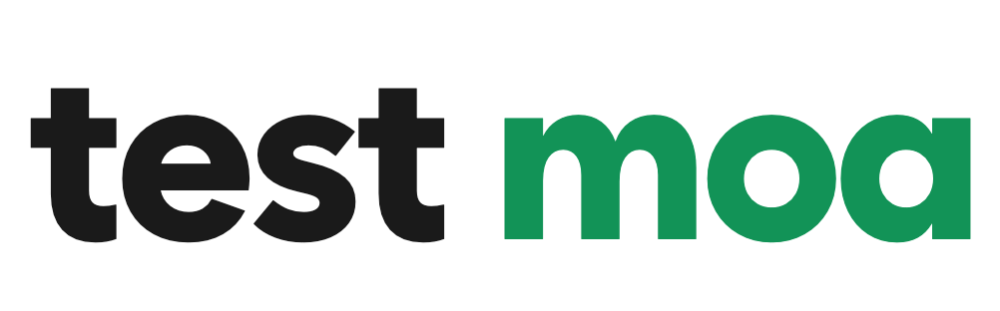
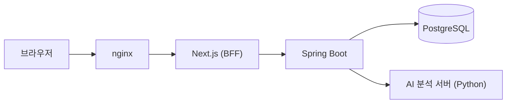
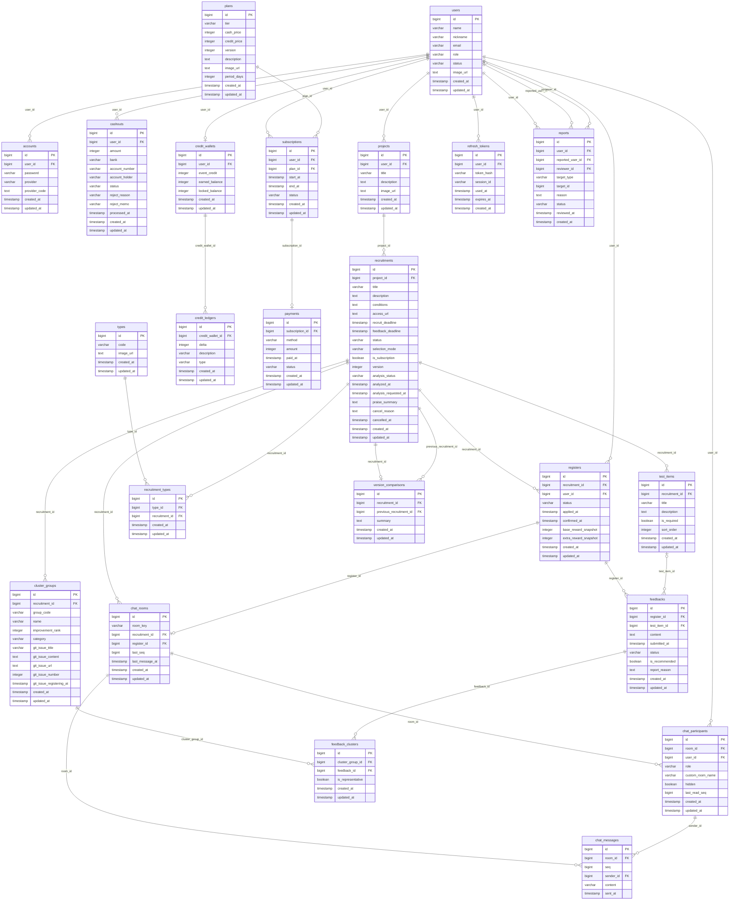

<a id="readme-top"></a>

<div align="center">
  <a href="https://github.com/likelion-backendschool-9th/test-moa/graphs/contributors"></a>
  <a href="https://github.com/likelion-backendschool-9th/test-moa/issues"></a>
  <a href="https://github.com/likelion-backendschool-9th/test-moa/pulls"></a>
</div>

<br/>

<div align="center">
  <a href="https://test-moa.newlecture.com">
    <picture>
      <source media="(prefers-color-scheme: dark)" srcset="docs/images/logo-dark.png">
      
    </picture>
  </a>

  <h3 align="center">써 보고, 남기고, 받고</h3>

  <p align="center">
    개발자와 테스터를 연결하는 소프트웨어 테스터 모집 플랫폼
    <br/>
    <a href="docs/README.md"><strong>문서 살펴보기 »</strong></a>
    <br/>
    <br/>
    <a href="https://test-moa.newlecture.com">테스트 서버</a>
    &middot;
    <a href="https://github.com/likelion-backendschool-9th/test-moa/issues/new?template=2-bug.yml">버그 제보</a>
    &middot;
    <a href="https://github.com/likelion-backendschool-9th/test-moa/issues/new?template=1-feature.yml">기능 제안</a>
  </p>
</div>

<br/>

<details>
  <summary>목차</summary>
  <ol>
    <li>
      <a href="#프로젝트-소개">프로젝트 소개</a>
      <ul>
        <li><a href="#기획-의도">기획 의도</a></li>
        <li><a href="#이용-흐름">이용 흐름</a></li>
        <li><a href="#주요-기능">주요 기능</a></li>
        <li><a href="#기술-스택">기술 스택</a></li>
      </ul>
    </li>
    <li>
      <a href="#시스템-설계">시스템 설계</a>
      <ul>
        <li><a href="#시스템-구성">시스템 구성</a></li>
        <li><a href="#데이터-모델">데이터 모델</a></li>
        <li><a href="#기술적으로-고민한-점">기술적으로 고민한 점</a></li>
      </ul>
    </li>
    <li>
      <a href="#시작하기">시작하기</a>
      <ul>
        <li><a href="#사전-준비">사전 준비</a></li>
        <li><a href="#설치-및-실행">설치 및 실행</a></li>
      </ul>
    </li>
    <li><a href="#로드맵">로드맵</a></li>
    <li><a href="#협업">협업</a></li>
    <li><a href="#팀">팀</a></li>
    <li><a href="#참고-문서">참고 문서</a></li>
  </ol>
</details>

<br/>
<br/>

## 프로젝트 소개


<p align="center"><sub>목업 데이터로 띄운 홈 화면입니다. 실제 시연 화면은 추가할 예정입니다.</sub></p>

<br/>

### 기획 의도

서비스를 만든 개발자에게는 실제로 써 보고 의견을 줄 사람이 필요합니다. 하지만 **적합한 테스터를 모으는 일도, 유용한 피드백을 받는 일도** 쉽지 않습니다. Test Moa는 이 두 가지 어려움을 함께 풀기 위해 시작했습니다.

| 어려움 | Test Moa의 방식 |
| --- | --- |
| 적합한 테스터를 찾기 어렵다 | 필요한 경험·관심사·사용 환경을 모집 조건으로 안내합니다. 개발 경험이 없어도 테스터가 될 수 있습니다. |
| 유용한 피드백을 받기 어렵다 | 요청한 항목별 수행 결과와 사용 경험, 버그 재현 방법을 정해진 양식으로 받습니다. |
| 테스터가 참여할 이유가 필요하다 | 피드백을 제출하면 크레딧으로 보상합니다. 버그를 찾지 못해도 요청한 테스트를 수행했다면 보상 대상입니다. |
| 모집 비용이 부담스럽다 | 무료로 모집할 수 있고, 개발자가 보상 예산을 따로 충전하지 않습니다. |

<br/>

### 이용 흐름

1. **등록** 개발자가 프로젝트를 등록하고 모집 글을 작성합니다.
2. **지원** 테스터가 조건과 일정을 확인하고 지원합니다.
3. **테스트** 참여가 확정되면 안내된 항목을 직접 사용해 봅니다.
4. **피드백** 수행 결과와 사용 경험, 발견한 버그를 제출합니다.
5. **보상** 제출 후 72시간 동안 신고가 없으면 크레딧을 지급합니다. 신고가 있으면 운영자가 검토합니다.

| | 무료 개발자 | 구독 개발자 |
| --- | --- | --- |
| 참여 확정 | 모집 인원까지 선착순 자동 확정 | 지원자 중 직접 선정 |
| 모집 글 노출 | 일반 목록 | 상단 전용 영역에 순환 노출 |
| 테스터와 1대1 채팅 | 없음 | 선정된 테스터와 가능 |

테스트로 받은 크레딧은 구독 결제에 쓰거나 현금으로 출금을 요청할 수 있습니다.

<br/>

### 주요 기능

| 기능 | 내용 |
| --- | --- |
| 회원 | 회원가입, 로그인, 소셜 로그인(Google·GitHub) |
| 모집 | 모집 목록·검색·상세, 테스트 지원 |
| 프로젝트 | 프로젝트 등록·수정, 모집 글 작성 |
| 모집 관리 | 지원자 선정, 받은 피드백 관리 |
| 참여 테스트 | 내 참여 목록, 피드백 제출 |
| 채팅 | 구독 개발자와 선정된 테스터의 실시간 1대1 대화 |
| 크레딧·구독 | 잔액·내역, 구독 결제, 출금 신청 |
| 운영자 | 신고 판정, 출금 처리 |
| AI 분석 | 리뷰 묶기·우선순위, 버전 비교, 후속 질문 추천 |

기능별 진행 상태는 [로드맵](#로드맵)에 있습니다.

<br/>

### 기술 스택

| 영역 | 기술 |
| --- | --- |
| 프론트엔드 |    |
| 백엔드 |     |
| 데이터베이스 |  |
| 인프라 |    |
| 테스트 |   |

<p align="right">(<a href="#readme-top">맨 위로</a>)</p>

<br/>
<br/>

## 시스템 설계

### 시스템 구성



<br/>

### 데이터 모델

서비스의 주요 테이블 23개와 관계입니다. 이미지·첨부 파일 테이블은 생략했습니다.



<br/>

### 기술적으로 고민한 점

- **실시간 채팅은 알림과 내용을 나눴습니다.** SSE로는 새 메시지가 있다는 알림만 보내고 내용은 REST로 받습니다. 연결이 끊겨도 마지막 순번 이후의 메시지를 다시 받아 빠짐없이 채웁니다.
- **느린 AI 호출이 DB 연결을 붙잡지 않게 했습니다.** 분석 서버는 트랜잭션 밖에서 호출하고, 결과는 받은 뒤 짧은 트랜잭션으로 저장합니다.
- **백엔드를 외부에 직접 열지 않았습니다.** 브라우저는 nginx를 거쳐 Next.js에만 접속하고, 백엔드는 Next.js가 서버 안에서 호출합니다.
- **출금 계좌 정보는 암호화해 저장합니다.** 계좌번호와 예금주는 DB에 AES-GCM 암호문으로 들어갑니다.
- **요구사항과 테스트를 같은 번호로 이었습니다.** 계획 문서의 시나리오 번호를 E2E 테스트 이름에 붙여, 어떤 요구사항을 어떤 테스트가 확인하는지 바로 찾을 수 있습니다.

<p align="right">(<a href="#readme-top">맨 위로</a>)</p>

<br/>
<br/>

## 시작하기

Docker Compose로 프론트엔드, 백엔드, PostgreSQL을 한 번에 띄웁니다.

<br/>

### 사전 준비

- [Docker](https://www.docker.com/) (Docker Compose 포함)

<br/>

### 설치 및 실행

1. 저장소를 내려받습니다.
   ```sh
   git clone https://github.com/likelion-backendschool-9th/test-moa.git
   cd test-moa
   ```
2. 환경 변수 파일을 만들고 값을 채웁니다. 각 값의 설명은 파일의 주석에 있습니다.
   ```sh
   cp .env.example .env
   ```
3. 서비스를 띄웁니다.
   ```sh
   docker compose up --build
   ```
4. 브라우저에서 `http://localhost:<TEAM_PORT>`로 접속합니다.

개발 모드, 로컬 HTTPS, 자주 쓰는 명령은 [실행 방법](docs/running.md)을 참고하세요.

<p align="right">(<a href="#readme-top">맨 위로</a>)</p>

<br/>
<br/>

## 로드맵

- [x] 회원가입·로그인·소셜 로그인
- [x] 모집 목록·검색·상세와 테스트 지원
- [x] 프로젝트 등록·수정과 모집 글 작성
- [x] 실시간 1대1 채팅
- [ ] 화면과 API 연결
  - [ ] 모집 관리
  - [ ] 참여 테스트와 피드백 제출
  - [ ] 크레딧·구독·출금
  - [ ] 운영자 신고 판정·출금 처리
  - [ ] AI 분석
- [ ] 모바일 앱·게임·API 테스트 지원 검토

실제 결제 대행(PG)과 송금은 아직 연동하지 않았습니다. 전체 작업은 [열린 이슈](https://github.com/likelion-backendschool-9th/test-moa/issues)에서 볼 수 있습니다.

<p align="right">(<a href="#readme-top">맨 위로</a>)</p>

<br/>
<br/>

## 협업

1. `develop`에서 `feature/기능이름` 브랜치를 만듭니다.
2. `유형: 변경 내용` 형식으로 커밋합니다.
3. `develop`으로 PR을 엽니다.
4. CI 통과와 팀원 1명의 승인을 받아 병합합니다.
5. 병합되면 테스트 서버에 자동으로 배포됩니다.

자세한 규칙은 [협업 규칙](CONTRIBUTING.md)을 참고하세요.

<p align="right">(<a href="#readme-top">맨 위로</a>)</p>

<br/>
<br/>

## 팀

<div align="center">
  <table>
    <tr>
      <td align="center" width="20%">
        <a href="https://github.com/isle-blu"></a>
        <br/><br/><strong>양덕관</strong>
        <br/><sub><a href="https://github.com/isle-blu">isle-blu</a></sub>
      </td>
      <td align="center" width="20%">
        <a href="https://github.com/jykim78982"></a>
        <br/><br/><strong>김재연</strong>
        <br/><sub><a href="https://github.com/jykim78982">jykim78982</a></sub>
      </td>
      <td align="center" width="20%">
        <a href="https://github.com/Dev-JihyeMoon"></a>
        <br/><br/><strong>문지혜</strong>
        <br/><sub><a href="https://github.com/Dev-JihyeMoon">Dev-JihyeMoon</a></sub>
      </td>
      <td align="center" width="20%">
        <a href="https://github.com/j0615671-arch"></a>
        <br/><br/><strong>이재용</strong>
        <br/><sub><a href="https://github.com/j0615671-arch">j0615671-arch</a></sub>
      </td>
      <td align="center" width="20%">
        <a href="https://github.com/songmin04"></a>
        <br/><br/><strong>최송민</strong>
        <br/><sub><a href="https://github.com/songmin04">songmin04</a></sub>
      </td>
    </tr>
  </table>
</div>

<p align="right">(<a href="#readme-top">맨 위로</a>)</p>

<br/>
<br/>

## 참고 문서

- [실행 방법](docs/running.md): 개발 모드, 로컬 HTTPS, 배포
- [협업 규칙](CONTRIBUTING.md): 브랜치, 커밋 메시지, PR
- [프론트엔드 안내](frontend/README.md): 폴더 구조, 테스트 명령
- [계획 문서](docs/README.md): 도메인별 요구사항과 결정 기록

<p align="right">(<a href="#readme-top">맨 위로</a>)</p>
