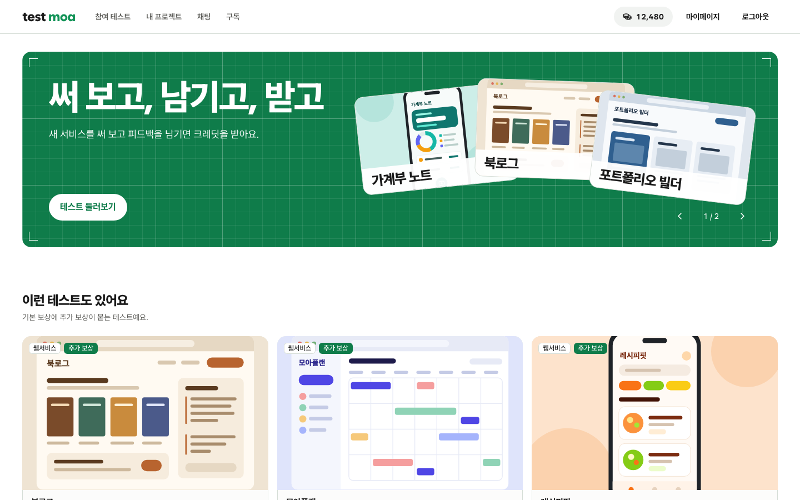
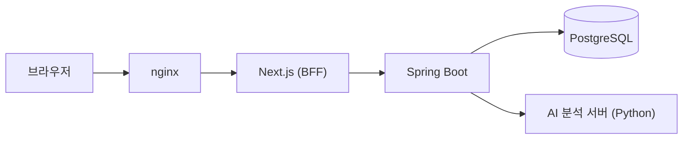

<div align="center">
  
  <h1>Test Moa</h1>
  <p><strong>써 보고, 남기고, 받고</strong></p>
  <p>개발자와 테스터를 연결하는 소프트웨어 테스터 모집 플랫폼</p>
  <p><a href="https://test-moa.newlecture.com">테스트 서버</a> · <a href="docs/running.md">실행 방법</a> · <a href="CONTRIBUTING.md">협업 규칙</a></p>
</div>



<p align="center"><sub>목업 데이터로 띄운 홈 화면입니다. 실제 시연 화면은 추가할 예정입니다.</sub></p>

## 기획 의도

서비스를 만든 개발자에게는 실제로 써 보고 의견을 줄 사람이 필요합니다. 하지만 **적합한 테스터를 모으는 일도, 유용한 피드백을 받는 일도** 쉽지 않습니다. Test Moa는 이 두 가지 어려움을 함께 풀기 위해 시작했습니다.

| 어려움 | Test Moa의 방식 |
| --- | --- |
| 적합한 테스터를 찾기 어렵다 | 필요한 경험·관심사·사용 환경을 모집 조건으로 안내합니다. 개발 경험이 없어도 테스터가 될 수 있습니다. |
| 유용한 피드백을 받기 어렵다 | 요청한 항목별 수행 결과와 사용 경험, 버그 재현 방법을 정해진 양식으로 받습니다. |
| 테스터가 참여할 이유가 필요하다 | 피드백을 제출하면 크레딧으로 보상합니다. 버그를 찾지 못해도 요청한 테스트를 수행했다면 보상 대상입니다. |
| 모집 비용이 부담스럽다 | 무료로 모집할 수 있고, 개발자가 보상 예산을 따로 충전하지 않습니다. |

첫 지원 대상은 링크로 접속하는 웹서비스이며, 모바일 앱·게임·API로 넓히는 것을 고려하고 있습니다.

## 이용 흐름

1. **등록** 개발자가 프로젝트를 등록하고 모집 글을 작성합니다.
2. **지원** 테스터가 조건과 일정을 확인하고 지원합니다.
3. **테스트** 참여가 확정되면 안내된 항목을 직접 사용해 봅니다.
4. **피드백** 수행 결과와 사용 경험, 발견한 버그를 제출합니다.
5. **보상** 제출 후 72시간 동안 신고가 없으면 크레딧을 지급합니다. 신고가 있으면 운영자가 검토합니다.

| | 무료 개발자 | 구독 개발자 |
| --- | --- | --- |
| 참여 확정 | 모집 인원까지 선착순 자동 확정 | 지원자 중 직접 선정 |
| 모집 글 노출 | 일반 목록 | 상단 전용 영역에 순환 노출 |
| 테스터와 1대1 채팅 | 없음 | 선정된 테스터와 가능 |

테스트로 받은 크레딧은 구독 결제에 쓰거나 현금으로 출금을 요청할 수 있습니다.

## 주요 기능

| 기능 | 내용 | 상태 |
| --- | --- | --- |
| 회원 | 회원가입, 로그인, 소셜 로그인(Google·GitHub) | 연결 완료 |
| 모집 | 모집 목록·검색·상세, 테스트 지원 | 연결 완료 |
| 프로젝트 | 프로젝트 등록·수정, 모집 글 작성 | 연결 완료 |
| 채팅 | 구독 개발자와 선정된 테스터의 실시간 1대1 대화 | 연결 완료 |
| 모집 관리 | 지원자 선정, 받은 피드백 관리 | 화면 연결 중 |
| 참여 테스트 | 내 참여 목록, 피드백 제출 | 화면 연결 중 |
| 크레딧·구독 | 잔액·내역, 구독 결제, 출금 신청 | 화면 연결 중 |
| 운영자 | 신고 판정, 출금 처리 | 화면 연결 중 |
| AI 분석 | 리뷰 묶기·우선순위, 버전 비교, 후속 질문 추천 | 화면 연결 중 |

<sub>연결 완료는 화면과 백엔드 API가 이어진 기능, 화면 연결 중은 백엔드 API는 있고 화면을 연결하고 있는 기능입니다. 실제 결제 대행(PG)과 송금은 아직 연동하지 않았습니다.</sub>

## 기술 스택

| 영역 | 기술 |
| --- | --- |
| 프론트엔드 | Next.js 16, React 19, TypeScript, CSS Modules |
| 백엔드 | Java 21, Spring Boot 4.1, Spring Security, JPA |
| 데이터베이스 | PostgreSQL 17 |
| 인프라 | Docker Compose, nginx, GitHub Actions, GHCR |
| 테스트 | JUnit, Playwright |

## 시스템 구성



## 기술적으로 고민한 점

- **실시간 채팅은 알림과 내용을 나눴습니다.** SSE로는 새 메시지가 있다는 알림만 보내고 내용은 REST로 받습니다. 연결이 끊겨도 마지막 순번 이후의 메시지를 다시 받아 빠짐없이 채웁니다.
- **느린 AI 호출이 DB 연결을 붙잡지 않게 했습니다.** 분석 서버는 트랜잭션 밖에서 호출하고, 결과는 받은 뒤 짧은 트랜잭션으로 저장합니다.
- **백엔드를 외부에 직접 열지 않았습니다.** 브라우저는 nginx를 거쳐 Next.js에만 접속하고, 백엔드는 Next.js가 서버 안에서 호출합니다.
- **출금 계좌 정보는 암호화해 저장합니다.** 계좌번호와 예금주는 DB에 AES-GCM 암호문으로 들어갑니다.
- **요구사항과 테스트를 같은 번호로 이었습니다.** 계획 문서의 시나리오 번호를 E2E 테스트 이름에 붙여, 어떤 요구사항을 어떤 테스트가 확인하는지 바로 찾을 수 있습니다.

## 팀

| 이름 | GitHub |
| --- | --- |
| 양덕관 | [@isle-blu](https://github.com/isle-blu) |
| 김재연 | [@jykim78982](https://github.com/jykim78982) |
| 문지혜 | [@Dev-JihyeMoon](https://github.com/Dev-JihyeMoon) |
| 이재용 | [@j0615671-arch](https://github.com/j0615671-arch) |
| 최송민 | [@songmin04](https://github.com/songmin04) |

## 실행하기

Docker만 있으면 전체 서비스를 한 번에 띄울 수 있습니다.

```sh
cp .env.example .env   # 값을 채웁니다
docker compose up --build
```

`http://localhost:<TEAM_PORT>`로 접속합니다. 자세한 내용은 [실행 방법](docs/running.md)을 참고하세요.

## 더 보기

- [협업 규칙](CONTRIBUTING.md): 브랜치, 커밋 메시지, PR
- [프론트엔드 안내](frontend/README.md): 폴더 구조, 테스트 명령
- [계획 문서](docs/README.md): 도메인별 요구사항과 결정 기록
