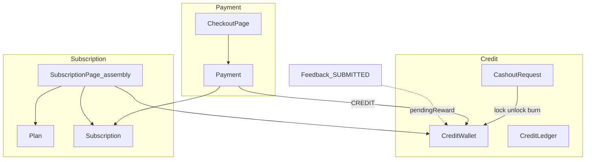
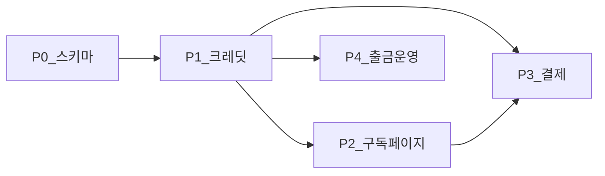

# 백엔드 결제·구독·크레딧 전체 계획

- 상태: 로드맵. 세부 계획은 유스케이스 단위 문서
  - 크레딧: `docs/2026-11-03-backend-credit.md`
  - 구독(+ 구독 페이지 구성): `docs/2026-11-03-backend-subscription.md`
  - 결제(+ checkout 페이지): `docs/2026-11-03-backend-payment.md`
- 끝나면: 서버가 크레딧·출금·구독 상태·구독 결제의 진실 공급원이 되고, 구독 관리/결제 화면에 필요한 데이터가 API로 조립된다. 프론트 목업 제거는 이후 별 PR.

## 1. 목적

프론트 목업 규칙을 백엔드가 갖게 한다.

- 프론트: `docs/2026-10-30-frontend-credits.md`, `docs/2026-10-30-frontend-subscription.md`
- 기획: `README.md` 구독과 크레딧
- 엔티티 골격: `Plan`, `Subscription`, `Payment`, `CreditWallet`, `CreditLedger`, `CashoutRequest`
- 비어 있는 것: Repository, Service, API, 트랜잭션, **구독 페이지를 채울 읽기 조립**

## 2. 범위

### 한다

- 크레딧 잔액·내역·출금 신청/운영 처리
- **구독 관리 페이지(`/my/subscription`) 구성에 필요한 조회·조립**
- 구독 결제 checkout(`/my/subscription/checkout`) 조회·실행
- 규칙: 이벤트/적립, 잠금, 이벤트 우선 차감, 만료일 결제 시점 고정

### 하지 않는다 (지금은)

- 실제 PG·송금·실명 확인
- 구독 해지, 공개 요금제 페이지
- 프론트 목업 제거·API 연동 완료 (계약 안정 후)
- 인증 본구현 (식별은 임시)

## 3. 도메인 경계

| 도메인 | 책임 | 주요 테이블 / 화면 |
| --- | --- | --- |
| 크레딧 | 잔액, 장부, 출금 | wallet, ledger, cashout → `/my/credits`, `/admin/withdrawals` |
| 구독 | 플랜·상태·**구독 페이지 섹션 조립** | plans, subscriptions → `/my/subscription` |
| 결제 | checkout 조회·실행, 만료일 갱신 | payments → `/my/subscription/checkout` |

승인 대기 보상은 wallet 컬럼이 아니라 `Feedback(SUBMITTED)` 합이다.

## 4. 공통 설계

1. Payment : Subscription = **N : 1**
2. CashoutRequest에 계좌 필드 (`bank`, `accountNumber`, `accountHolder`, `rejectReason`)
3. 크레딧 차감: 이벤트 먼저, 잠금분 제외
4. 장부: 잔액이 바뀐 사건만 (출금 잠금/해제는 ledger에 안 남김)
5. 미정 가격·한도: Plan 시드
6. 트랜잭션: 결제·출금은 한 메서드. 결제가 크레딧 서비스를 호출

## 5. 작업 순서

| 단계 | 내용 | 문서 |
| --- | --- | --- |
| P0 | 스키마 갭 | 크레딧 C0, 결제 P0 |
| P1 | 크레딧 UC | `2026-11-03-backend-credit.md` |
| P2 | 구독 UC + **구독 페이지 구성** | `2026-11-03-backend-subscription.md` |
| P3 | 결제 UC + checkout 페이지 | `2026-11-03-backend-payment.md` |
| P4 | 운영자 출금 | 크레딧 C5~C7 |

**구현·계획 순서: 크레딧 → 구독(페이지 구성) → 결제.**  
단위는 페이지가 아니라 **유스케이스**. 구독만 “페이지 섹션 ↔ UC 매핑”을 문서에 명시한다.

## 6. 프론트 계약

- API 필드: `eventCredit`, `earnedBalance`, `lockedBalance`
- 인증 전: `userId` 경로
- 목업 쿠키 제거는 연동 PR

## 7. 문서 규칙

로드맵·세부 계획은 `docs/*.md`. 구현 PR에서 해당 계획 문서를 같이 갱신한다.

## 8. WIP

`feature/backend-credit-subscription`의 조기 구현은 **세부 계획 합의 전 보류**. 합의 후 맞으면 이어가고, 아니면 develop에서 다시.

## 9. 바로 다음

1. 세 세부 문서 합의
2. 크레딧 C0~C2부터 구현
