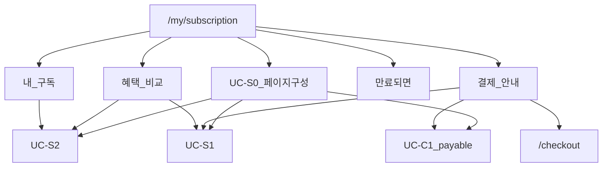

# 백엔드 구독 세부 계획 (유스케이스 + 페이지 구성)

- 상위: `docs/2026-11-03-backend-payment-subscription-credit.md`
- 선행: 크레딧 UC-C1 (결제 가능 크레딧)
- 프론트: `docs/2026-10-30-frontend-subscription.md` (`/my/subscription`)
- 단위: 유스케이스. **이 문서는 구독 관리 페이지를 섹션 단위로 구성하는 일까지 포함한다.**
- 쓰기(시작/연장): `docs/2026-11-03-backend-payment.md`

## 한눈에

구독 도메인은 읽기 + **페이지 조립**이다.  
`/my/subscription`에 보이는 블록(내 구독 · 혜택 비교 · 결제 안내 · 만료되면)에 필요한 API를 만들고, 페이지가 한 번에 그릴 수 있게 **구성용 조회(UC-S0)** 를 둔다. checkout 화면·결제는 결제 문서.

## 구독 페이지 구성 (`/my/subscription`)

프론트 화면 순서와 백엔드 UC 매핑.

| 섹션 | 화면 역할 | 공급 UC | 비고 |
| --- | --- | --- | --- |
| 접근·대상 | 비로그인/운영자 | S0 / S2 | 운영자: eligible=false, 혜택·결제 안내 숨김 |
| 내 구독 | 미구독/구독 중, D-n, 만료일, 이번 달 모집 | S2 (S0에 포함) | 모집 사용량은 없으면 null·자리만 |
| 혜택 비교 | 무료 vs 구독 표, 지금 이용 중 열 | S1 + S2 + 혜택 메타 | 문구는 시드/상수 가능 |
| 결제 안내 | 가격·기간·쓸 수 있는 크레딧·checkout 링크 | S1 + C1 (S0/S3) | 버튼은 checkout으로 |
| 만료되면 | 구독 중일 때만 | S0 플래그 또는 정적 카피 | 데이터 거의 없음 |
| (연결) checkout | 구독하기/연장하기 | 결제 P1·P2 | 이 문서 범위 밖 |

**권장:** 페이지 진입 시 `UC-S0` 한 번으로 위 섹션 데이터를 받고, 개별 UC는 재사용·부분 갱신용.

---

## UC-S0 구독 페이지 구성 (조립)

- **하는 일**: `/my/subscription` 한 화면분 JSON 조립
- **API**: `GET /api/users/{userId}/subscription/page`
- **응답 뼈대**:
  - `eligible` (운영자 false면 아래 섹션 생략 가능)
  - `status` — UC-S2와 동일
  - `plans[]` — UC-S1
  - `benefits` — 무료/구독 행·열 메타 (또는 프론트 상수; 있으면 여기)
  - `paymentPreview` — payableCredits, checkoutPath
  - `showExpiryHints` — active일 때 true
- **규칙**: 내부에서 S1·S2·Credit C1 호출. 트랜잭션 읽기 전용
- **완료 기준**: 테스터/개발자/운영자 각각 프론트 시나리오(S195~S204, S201)에 필요한 필드가 채워짐

## UC-S1 플랜 목록

- API: `GET /api/plans`
- 응답: id, tier, cashPrice, creditPrice, periodDays, monthlyRecruitLimit, description, imageUrl, version
- 시드: 30일 / 현금 10,000 / 크레딧 9,000 / 월 30
- 화면: 혜택 비교 열머리, 결제 안내 상품

## UC-S2 내 구독 상태

- API: `GET /api/users/{userId}/subscription`
- 응답: eligible, active, plan, startAt, endAt, daysLeft, monthlyRecruitLimit, monthlyRecruitRemaining(nullable)
- 규칙: endAt 지나면 active=false로 응답 (컬럼 보정은 결제/배치)
- 화면: 내 구독 카드, 마이 홈 구독 요약

## UC-S3 결제 안내 요약 (부분 조회)

- API: `GET /api/users/{userId}/subscription/payment-preview`
- 응답: plans[], payableCredits, active, endAt, checkoutPath
- S0에 포함되므로 **단독은 선택**. checkout 진입 전 갱신용으로 유지 가능
- 화면: 결제 안내 카드

## UC-S4 혜택 비교 메타 (선택)

- 기본: 프론트 문서 표 유지 가능
- 서버에 둘 경우: S0.benefits 또는 `GET /api/plans/benefits`
- 이 단계 기본값은 **S0에 시드 상수로 넣거나 프론트 유지**

---

## PR 묶음

1. Plan 시드 + S1 + S2  
2. **S0 구독 페이지 구성** (C1 의존)  
3. S3 (필요 시) / 혜택 메타

## 범위 밖

- 구독 시작·연장·해지 → 결제 문서  
- 이번 달 모집 **사용량** 집계 (프로젝트 도메인; remaining은 null 허용)  
- 공개 `/pricing`  
- checkout UI 데이터 → 결제 문서

## 다음

`docs/2026-11-03-backend-payment.md`
