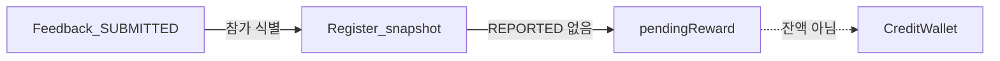

# 백엔드 크레딧 잔액·내역 조회

시나리오 제목 끝의 태그가 확인 방법이다. `[테스트]`만 이 문서 시나리오와 백엔드 테스트가 1:1이고, `[직접]`은 사람이 API·화면·코드로 확인한다.

이슈: `#66`. 요구·시나리오는 `#66-R…`, `#66-S…`부터 센다. 엔티티·출금·구독·결제 전체는 [payment/README.md](payment/README.md)·[payment/entities.md](payment/entities.md). 참가·피드백은 [project/entities.md](project/entities.md).

## 한눈에
- 끝나면: `GET`으로 잔액 구성·승인 대기·장부 내역을 내려 `/my`·`/my/credits`가 쓸 수 있다. 프론트 목업 제거는 이후 별 PR.
- 인증은 토큰의 회원 id다. 경로는 `/api/v1/my/credits`이고, 주소에 회원 id가 없다.
- 브랜치: `feature/backend-credit-balance-ledger`
- 화면: `docs/frontend/payment/credits.md`, `docs/frontend/payment/credit-labels.md`

## API

| 메서드 | 경로 | 설명 |
| --- | --- | --- |
| `GET` | `/api/v1/my/credits` | 잔액·승인 대기·파생 값. 로그인 필요 |
| `GET` | `/api/v1/my/credits/ledger?type=all\|in\|out` | 장부. 최신순. 잘못된 type은 400 |

### 잔액 응답 필드

| 필드 | 의미 |
| --- | --- |
| `earnedBalance` | 적립. 잠긴 분 미포함. 출금 가능액과 같음 |
| `eventCredit` | 이벤트. 구독 결제 전용 |
| `lockedBalance` | 출금 처리 중 |
| `pendingReward` | 승인 대기. **잔액 아님** |
| `totalCredits` | `earnedBalance + eventCredit + lockedBalance` |
| `payableCredits` | `earnedBalance + eventCredit` |
| `cashableCredits` | `earnedBalance` |

`pendingReward`는 위 파생 값에 넣지 않는다. 화면의 「승인 대기」 안내용이다.

### 내역 필터

| `type` | 조건 |
| --- | --- |
| `all` (기본) | 전체 |
| `in` | `delta > 0` |
| `out` | `delta < 0` |

구독 결제 장부는 EVENT/EARNED가 두 줄로 남을 수 있다. 프론트 연동 때 한 줄 목업을 고친다.

---

## 승인 대기 보상 (`pendingReward`)

지갑 컬럼이 아니다. 조회 때 계산한다(#45-S21, #91).

### 왜 Register 스냅샷인가

보상은 **참가(Register)당 1번**이다. 테스트 항목마다 Feedback 행이 생겨도 금액은 `Register.baseRewardSnapshot + extraRewardSnapshot` 한 세트다.

Feedback 행의 합으로 세면 항목 수만큼 중복된다. 그래서 `Feedback(SUBMITTED)`가 **있는 참가**를 고른 뒤, 그 Register 스냅샷을 **참가당 1회**만 더한다.

| 방식 | 예: 스냅샷 1,350 · Feedback 3줄 | 결과 |
| --- | --- | --- |
| Feedback 행 합 (쓰지 않음) | 1,350 × 3 | 4,050 |
| Register 1회 (#66) | 참가 1건 | 1,350 |

### 왜 SUBMITTED만인가

Feedback 상태와 화면에 쓰는 말:

| 상태 | 의미 | `#66` 승인 대기 |
| --- | --- | --- |
| `SUBMITTED` | 제출됨, 지급 대기 | **포함** |
| `REPORTED` | 신고·검토 중 | **제외** |
| `REWARDED` | 지급 처리됨 | 제외 |
| `EXCLUDED` | 보상 제외 | 제외 |

「승인 대기」는 **문제 없이 제출되어 지급을 기다리는 금액**으로 보인다. `REPORTED`까지 넣으면 검토 중인데도 받을 것처럼 읽힐 수 있다. 검토 중을 따로 보여 주는 필드·UI는 이후에 둔다.

`pendingReward`에 넣어도 지갑에 들어오거나 출금·결제에 쓰이지는 않는다. 잔액과 별도 숫자다.

### 계산 요약

1. 해당 유저의 Register 중 **`status = CONFIRMED`** 이고  
2. `Feedback.status = SUBMITTED`인 행이 **하나라도** 있고  
3. `Feedback.status = REPORTED`인 행이 **없고**  
4. 스냅샷이 있는 참가만  
5. `SUM(baseRewardSnapshot + extraRewardSnapshot)` (참가당 1회)

`CANCELLED`·`REJECTED`는 넣지 않는다. 확정 뒤 취소된 참가에 Feedback이 남아 있어도 승인 대기에서 빠진다.

테스트 항목이 여러 개여서 같은 참가에 `SUBMITTED`와 `REPORTED`가 섞이면, 보상은 참가당 한 번이므로 **참가 전체를 승인 대기에서 뺀다**(지급 보류). [project/README.md](project/README.md)와 같다.

---

## 시나리오

#66-S1 잔액 조회 API [직접]
- API: `GET /api/v1/my/credits`
- Then  `earnedBalance`, `eventCredit`, `lockedBalance`, `pendingReward`, `totalCredits`, `payableCredits`, `cashableCredits`
- Then  `cashableCredits` = `earnedBalance`, `payableCredits` = `earnedBalance + eventCredit`, `totalCredits` = `earnedBalance + eventCredit + lockedBalance`
- Then  `pendingReward`는 잔액 필드에 포함되지 않는다
- 화면: `/my`, `/my/credits`

#66-S2 내역 조회 API [직접]
- API: `GET /api/v1/my/credits/ledger?type=all|in|out`
- Then  `in`은 delta>0, `out`은 delta<0. 잘못된 type은 400
- Then  구독 결제는 EVENT/EARNED 행을 두 줄로 응답한다 (프론트 연동 때 한 줄 목업을 고침)
- 화면: `/my/credits`

#66-S3 승인 대기는 참가당 1회·SUBMITTED만·REPORTED 보류 [테스트]
- Given 같은 `Register(CONFIRMED)` 스냅샷 1,000+350, `Feedback(SUBMITTED)` 2줄
- When  `RegisterRepository.sumPendingRewardByUserId`
- Then  합은 1,350이다 (피드백 행 합 2,700이 아니다)
- Given 같은 참가의 피드백이 `REPORTED`만 있을 때
- Then  합은 0이다 (검토 중은 승인 대기에 넣지 않는다)
- Given 같은 참가에 `SUBMITTED` 1줄과 `REPORTED` 1줄이 섞여 있을 때
- Then  합은 0이다 (한 건이라도 신고면 참가 전체 지급 보류)

#66-S4 취소된 참가는 승인 대기에서 제외 [테스트]
- Given `Register`를 확정·피드백 제출 뒤 `cancel()`한 참가
- When  `sumPendingRewardByUserId`
- Then  합은 0이다

#66-S5 토큰의 회원만 자기 크레딧을 본다 [테스트]
- Given 회원 B의 장부에 한 줄이 있다. 주소에는 회원 id가 없다
- When  A의 토큰으로 `GET /api/v1/my/credits`, `GET /api/v1/my/credits/ledger`
- Then  잔액의 `userId`는 A다. 내역에 B의 장부 id가 없다
- When  B의 토큰으로 `GET /api/v1/my/credits/ledger`
- Then  그 장부 id가 보인다
- When  토큰 없이 `GET /api/v1/my/credits`
- Then  401이다

---

## 구현 메모
- Repository / Service / Controller. 읽기 전용 트랜잭션.
- 승인 대기 합산은 `RegisterRepository` 조회(`CONFIRMED` + EXISTS SUBMITTED + NOT EXISTS REPORTED + 스냅샷 SUM). `#66-S3`·`#66-S4`는 `@DataJpaTest`로 JPQL을 확인한다.
- 지갑이 없으면 잔액 필드는 0, 승인 대기는 그래도 계산한다.
- 회원 id는 `@AuthenticationPrincipal`로 받는다. 토큰이 없거나 쓸 수 없는 회원이면 401이다.
- `CreditWallet` 주석·이 문서·[payment/entities.md](payment/entities.md) 요약이 같은 규칙을 가리킨다.

## 범위 밖
- 출금 신청·내역 (#67), 운영자 출금 (#68)
- 구독·checkout (#69~#71)
- `REPORTED`용 「검토 중」 금액 필드·화면
- 프론트 목업 제거
