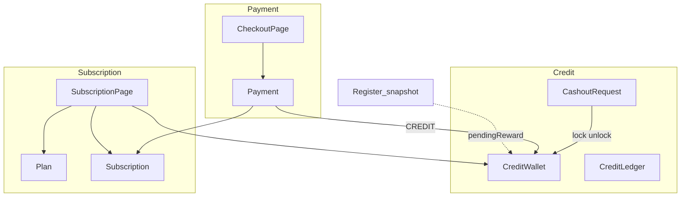
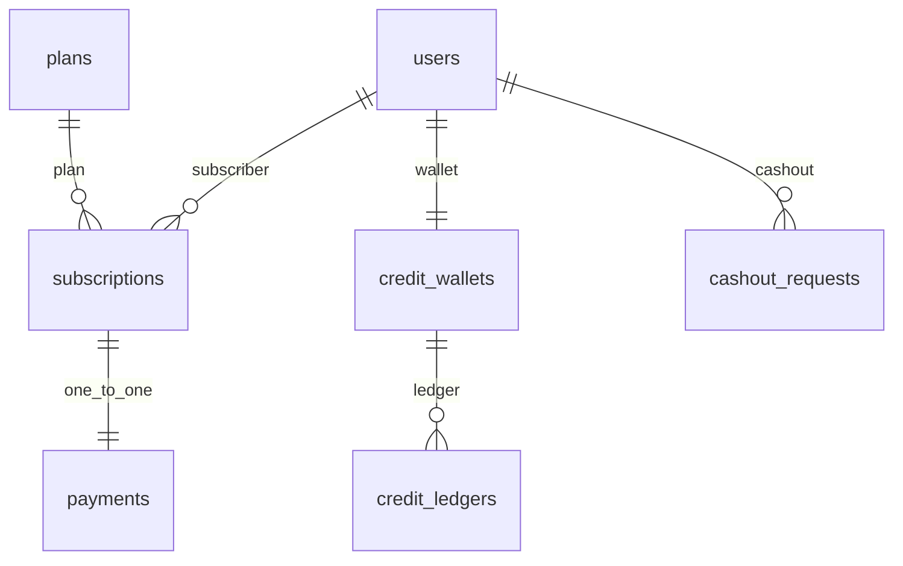
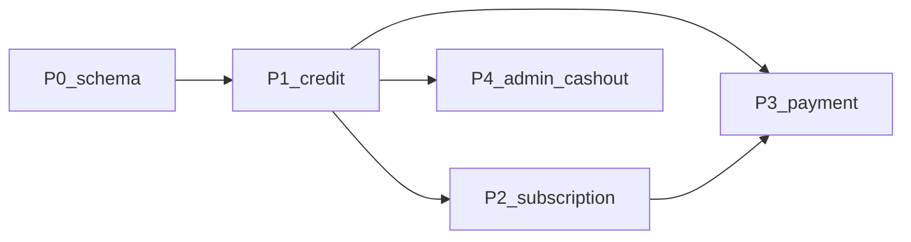

# 백엔드 결제·구독·크레딧

시나리오 제목 끝의 태그가 확인 방법이다. `[테스트]`만 이 문서 시나리오와 백엔드 테스트가 1:1이고, `[테스트: 파일 번호]`는 **다른** 테스트가 대신 확인할 때 쓴다(예: `credits.spec.ts S352`). `[명령]`은 명령 한 번, `[직접]`은 사람이 API·화면·코드로 확인한다.

이슈: 엔티티 `#45`, API `#66`~`#71`. 요구·시나리오는 `#이슈-R1`, `#이슈-S1`부터 센다.

## 한눈에
- 끝나면: 서버가 크레딧 잔액·내역·출금, 구독 상태, 구독 결제(시작/연장)의 진실 공급원이 되고, `/my/subscription`·`/my/subscription/checkout`·`/my/credits`·`/admin/withdrawals`에 필요한 데이터가 API로 조립된다. 프론트 목업 제거는 이후 별 PR.
- 엔티티(`Plan`, `Subscription`, `Payment`, `CreditWallet`, `CreditLedger`, `CashoutRequest`) P0는 반영됨. 없는 것은 Repository, Service, API, 트랜잭션.
- 결정 필요: 계좌 저장 방식, `SubscriptionStatus.EXPIRED` 유지 여부, 미리 결제 기간 상한(아래 정해야 할 것).
- 규모: 크레딧 → 구독 페이지 구성 → 결제 → 운영자 출금.
- 브랜치: `feature/backend-credit-balance-ledger` (#66)
- 프론트: `docs/frontend/credits.md`, `docs/frontend/credit-labels.md`, `docs/frontend/subscription.md`, `docs/frontend/admin-withdrawals.md`

## 맥락
- 프론트 목업 규칙을 백엔드가 갖게 한다. 인증은 당분간 `userId` 경로.
- **DB는 지금 ERD보다 복잡하게 만들지 않는다.** 테이블을 늘리지 않고, 컬럼도 꼭 필요한 것(`reject_memo`)만 더한다.
- **조건이 붙는 규칙은 DB가 아니라 백엔드가 맡는다.**

| 어디서 | 무엇을 |
| --- | --- |
| 요청 DTO | 값 하나만 보면 되는 검사(정해진 값인지, 길이 상한, 계좌번호 숫자 10~14자리) |
| 엔티티 메서드 | 상태 전이와 값끼리의 규칙(`pay()`, `reject()`, 지갑 `lockForCashout()` 등). setter는 두지 않는다 |
| 서비스 | 다른 테이블까지 보는 규칙(이미 처리된 요청인지, 결제 순서와 행 잠금, 장부 기록) |

| 도메인 | 책임 | 화면 |
| --- | --- | --- |
| 크레딧 | 잔액, 장부, 출금 | `/my/credits`, `/admin/withdrawals` |
| 구독 | 플랜·상태·페이지 조립 | `/my/subscription` |
| 결제 | checkout 조회·실행 | `/my/subscription/checkout` |

승인 대기(`pendingReward`)는 wallet 컬럼이 아니다. `CONFIRMED` 참가 중 `Feedback(SUBMITTED)`가 있는 Register 스냅샷을 참가당 1회 합산한다(#91). 규칙·API 상세는 [credit-balance-ledger.md](credit-balance-ledger.md).





모든 엔티티에 `created_at`·`updated_at`이 있어 표에서는 뺐다. ERD와 코드의 테이블·PK 이름(단수/복수, `id` vs `*_id`)은 나중에 맞춘다. ERD 그림에서는 payment와 subscription 사이를 **1:1**로 그리고, 값 설명만 고치면 된다.

### 정한 것

| # | 대상 | 정한 것 | 코드 |
| --- | --- | --- | --- |
| 1 | `CashoutRequest` | 계좌·예금주, 반려 사유 enum, `reject_memo`, `pay()`·`reject()` | 반영됨 |
| 2 | `CashoutStatus` | `COMPLETED` 제거 | 반영됨 |
| 3 | `CreditType` | `LOCKED` 제거 | 반영됨 |
| 4 | `Payment` ↔ `Subscription` | 구독 1 : 결제 1 | 반영됨 |
| 5 | `CreditLedger` | 결제 ID 없이 변동량만 | 반영됨 |
| 6 | `CreditWallet` | 적립에 잠긴 금액 미포함. setter 없이 메서드만 | 반영됨 |
| 7 | `Plan` | 조건 변경 시 새 행·version↑. 무료는 행으로 두지 않음. `(tier, version)` unique | 반영됨 |

### 이슈 #45 시나리오 확인

이슈 본문의 번호 목록은 이슈를 닫는 조건이고, `#45-S…` 번호는 이 문서에서만 매긴다. 서비스가 하는 일은 해당 API 이슈로 넘긴다.

| 이슈 #45 | 확인 | 상태 |
| --- | --- | --- |
| 1 신청은 요청 상태 | #45-S13 | 됨 |
| 2 지급 완료, "완료" 상태 없음 | #45-S14, #45-S23 | 됨 |
| 3 반려 사유 선택, 반려 상태·처리 일시 | #45-S16, #45-S19 | 됨 |
| 4 기타는 메모 필수, 다른 사유 메모는 운영자 메모 | #45-S17, #45-S18 | 됨 |
| 5 이미 처리한 요청은 다시 처리 불가 | #45-S15, #45-S20 | 됨 |
| 6 신청은 적립 → 잠김, 반려는 잠김 → 적립, 장부 없음 | #45-S3, #45-S4, #45-S7, #45-S8 | 됨 (장부를 남기지 않는 것은 #67-S2, #68-S1) |
| 7 지급하면 잠김에서 빠지고 장부 한 줄 | #45-S5, #45-S6 | 됨 (장부 행은 #68-S1) |
| 8 출금 가능·결제 가능·총잔액 계산 | #45-S1, #45-S2 | 됨 |
| 9 장부는 종류·변동량만, 구독 결제는 두 줄 | #45-S9~S11, #45-S22 | 됨 (장부 행은 #71-S1) |
| 10 승인 대기 보상은 지갑에 저장하지 않음 | #45-S21 | 됨 |
| 11 결제 1건 = 구독 1건 | #45-S27 | 됨 |
| 12 구독 중 결제는 이어지는 새 구독 | #71-S1 | 서비스 |
| 13 상태는 ACTIVE로 시작, 환불만 CANCELLED. 구독 중은 날짜로 판단 | #45-S25, #45-S26 (날짜 판단은 #69-S3) | 됨 |
| 14 플랜 조건이 바뀌면 새 행·버전 | #45-S24 | 됨 (새 행을 만드는 기능은 플랜 관리가 생길 때) |
| 15 무료는 플랜으로 저장하지 않음 | #69-S1 | 시드·목록 |

---

## 1. 잔액 (#45-R1)

지갑은 사용자마다 하나이고 가입할 때 만든다. 적립 잔액에 잠긴 금액을 넣지 않는다. 읽기·변경은 엔티티 메서드로 두고 setter는 쓰지 않는다.

### `credit_wallets`

| 필드 | 컬럼 | 타입 | null | 설명 |
| --- | --- | --- | --- | --- |
| `id` | `id` | Long | 불가 | PK |
| `user` | `user_id` | FK → users | 불가 | 지갑 주인 (`@OneToOne`) |
| `eventCredit` | `event_credit` | Integer | 불가 | 이벤트 크레딧. 구독 결제 가능, 출금 불가. 0으로 시작 |
| `earnedBalance` | `earned_balance` | Integer | 불가 | 적립 잔액. 잠긴 금액 미포함. 출금 가능액과 같음 |
| `lockedBalance` | `locked_balance` | Integer | 불가 | 출금 처리 중. 0으로 시작 |

| 필드 | 출금 | 구독 결제 |
| --- | --- | --- |
| `earnedBalance` | 가능 | 가능(이벤트 다음) |
| `eventCredit` | 불가 | 가능(먼저) |
| `lockedBalance` | 불가 | 불가 |
| `pendingReward` | 잔액 아님 | 잔액 아님 |

- 출금 가능 = `earnedBalance` (`cashable()`)
- 구독 결제 가능 = `earnedBalance + eventCredit` (`payable()`)
- 총잔액 = `earnedBalance + eventCredit + lockedBalance` (`total()`)
- 1크레딧 = 1원. 금액은 1 이상만. 잔액 부족 검사는 메서드 안. 장부 행은 서비스가 남긴다.

#45-S1 처음 잔액은 0 [테스트]
- Given 새 `CreditWallet`
- Then  `cashable()`·`payable()`·`total()`이 0이다

#45-S2 지급 후 계산 [테스트]
- Given `grantEvent(3000)`, `grantEarned(6000)`
- Then  `cashable()` 6000, `payable()` 9000, `total()` 9000

#45-S12 금액이 1 미만이면 거절 [테스트]
- When  `grantEvent(0)` 또는 `grantEarned(-1)` 또는 `lockForCashout(0)`
- Then  `IllegalArgumentException`

#45-S21 승인 대기 보상은 지갑 컬럼이 아님 [직접]
- `CreditWallet`에 `pendingReward` 필드가 없다. 조회 규칙은 [credit-balance-ledger.md](credit-balance-ledger.md) (#66-S1, #66-S3, #91)

잔액·내역 조회 API(#66-S1~S3)는 [credit-balance-ledger.md](credit-balance-ledger.md)에 둔다.

---

## 2. 크레딧 내역 (#45-R2)

장부에는 **총잔액이 실제로 바뀐 일만** 남긴다. `CreditType`은 `EVENT`, `EARNED`만 쓴다(`LOCKED` 제거).

### `credit_ledgers`

| 필드 | 컬럼 | 타입 | null | 설명 |
| --- | --- | --- | --- | --- |
| `id` | `id` | Long | 불가 | PK |
| `creditWallet` | `credit_wallet_id` | FK → credit_wallets | 불가 | 변동 지갑 |
| `delta` | `delta` | Integer | 불가 | 변동량(+/−) |
| `description` | `description` | String | 불가 | 원인 문구 |
| `type` | `type` | enum `CreditType` | 불가 | `EVENT` / `EARNED` |

결제 연결(`payment_id`)은 두지 않는다. 구독 결제 시 이벤트·적립을 각각 쓴 만큼 행을 만든다(0인 쪽은 행 없음). 내역 화면에는 두 줄이 그대로 보인다. **나중에 환불을 만들 때, 결제 하나에서 이벤트와 적립을 각각 얼마씩 뺐는지 장부만으로는 알 수 없다.** 환불은 지금 범위 밖이라 그때 정한다.

| 전 | 후 |
| --- | --- |
| `EVENT` / `EARNED` / `LOCKED` | `EVENT` / `EARNED` |

#45-S22 장부에는 종류와 변동량만 [직접]
- `CreditLedger`에 `payment` 필드가 없고, `CreditType`은 `EVENT`, `EARNED` 두 값이다

내역 조회 API(#66-S2)는 [credit-balance-ledger.md](credit-balance-ledger.md)에 둔다.

---

## 3. 출금 신청·내역 (#45-R3)

회원은 금액·계좌로 출금을 신청한다. 신청 시 적립에서 잠긴으로만 옮기고 장부는 없다.

### `cashout_requests`

| 필드 | 컬럼 | 타입 | null | 설명 |
| --- | --- | --- | --- | --- |
| `id` | `id` | Long | 불가 | PK |
| `user` | `user_id` | FK → users | 불가 | 요청자 |
| `amount` | `amount` | Integer | 불가 | 현금화 크레딧. 1크레딧=1원 |
| `bank` | `bank` | String | 불가 | 입금 은행 |
| `accountNumber` | `account_number` | String | 불가 | 계좌 숫자 10~14자리. 저장 방식은 정해야 할 것 |
| `accountHolder` | `account_holder` | String | 불가 | 예금주 |
| `status` | `status` | enum `CashoutStatus` | 불가 | `REQUESTED` / `PAID` / `REJECTED` |
| `rejectReason` | `reject_reason` | enum (DB String) | 가능 | `HOLDER` / `ACCOUNT` / `OTHER` |
| `rejectMemo` | `reject_memo` | String | 가능 | OTHER면 회원 사유(필수), 그 외 운영자 메모 |
| `processedAt` | `processed_at` | datetime | 가능 | 지급·반려 일시 |

| 전 | 후 |
| --- | --- |
| REQUESTED / PAID / COMPLETED / REJECTED | REQUESTED / PAID / REJECTED |

상태는 `REQUESTED`에서 `PAID` 또는 `REJECTED`로 한 번만 바뀌고 되돌리지 않는다. 생성 시 상태는 항상 `REQUESTED`.

| 사건 | 지갑 | 장부 |
| --- | --- | --- |
| 출금 신청 | `lockForCashout(amount)` | 없음 |
| 출금 지급 | `confirmCashout(amount)` | `EARNED` −amount |
| 출금 반려 | `releaseCashout(amount)` | 없음 |

장부 `EARNED` 합 = `earnedBalance + lockedBalance`, `EVENT` 합 = `eventCredit`.

#45-S3 출금 잠금 [테스트]
- Given 적립 9,480
- When  `lockForCashout(5000)`
- Then  적립 4,480, 잠김 5,000, 총잔액 9,480

#45-S4 잠금 잔액 부족 [테스트]
- Given 적립 1,000
- When  `lockForCashout(1001)`
- Then  `IllegalArgumentException`

#45-S13 신청 상태는 REQUESTED [테스트]
- When  출금 요청을 만든다
- Then  `status`가 `REQUESTED`다

#45-S23 출금 상태에 "완료"가 없음 [직접]
- `CashoutStatus`는 `REQUESTED`, `PAID`, `REJECTED` 세 값이다. 지급 완료는 `PAID` 하나다

#67-S1 출금 내역 조회 [직접]
- API: `GET /api/users/{userId}/credits/cashouts`
- Then  처리 중·지급 완료·반려. 반려는 사유(OTHER면 메모) 포함
- 화면: `/my/credits/withdrawals` (`docs/frontend/credits.md` S358~)

#67-S2 출금 신청 API [직접]
- API: `POST /api/users/{userId}/credits/cashouts`
- Then  `CashoutRequest(REQUESTED)` + `lockForCashout` (구현 후 `[테스트]`)

---

## 4. 운영자 출금 (#45-R4)

운영자가 지급·반려한다. 대기 건만 계좌 전체, 완료는 끝 4자리(저장 방식은 정해야 할 것).

### 반려 사유 `CashoutRejectReason`

| 값 | 화면 문구 | 회원에게 보이는 사유 |
| --- | --- | --- |
| `HOLDER` | 예금주 이름이 회원 정보와 달라요 | 이 문구 |
| `ACCOUNT` | 계좌번호를 확인할 수 없어요 | 이 문구 |
| `OTHER` | 기타 | `rejectMemo` |

#45-S5 지급 시 잠긴 잔액만 줄임 [테스트]
- Given 잠긴 5,000
- When  `confirmCashout(5000)`
- Then  잠긴 0, 총잔액 감소

#45-S6 지급 시 잠긴 금액 초과 [테스트]
- Given 잠긴 5,000
- When  `confirmCashout(5001)`
- Then  `IllegalStateException`

#45-S7 반려 시 잠긴 금액을 적립으로 [테스트]
- Given 잠긴 5,000
- When  `releaseCashout(5000)`
- Then  적립 5,000, 잠긴 0

#45-S8 반려 시 잠긴 금액 초과 [테스트]
- Given 잠긴 5,000
- When  `releaseCashout(5001)`
- Then  `IllegalStateException`

#45-S14 지급 상태 전이 [테스트]
- Given REQUESTED
- When  `pay(now)`
- Then  상태 `PAID`, `processedAt` 기록

#45-S15 이미 처리한 요청 지급 거절 [테스트]
- Given 이미 `PAID`
- When  다시 `pay`
- Then  `IllegalStateException`

#45-S16 반려 상태 전이 [테스트]
- Given REQUESTED
- When  `reject(HOLDER, "확인 메모", now)`
- Then  상태 `REJECTED`, 사유·메모·처리 시각

#45-S17 OTHER 반려는 메모 필수 [테스트]
- When  `reject(OTHER, "  ", now)`
- Then  `IllegalArgumentException`

#45-S18 OTHER가 아니면 빈 메모는 저장하지 않음 [테스트]
- When  `reject(ACCOUNT, "   ", now)`
- Then  `rejectMemo`가 null

#45-S19 반려 사유 없으면 거절 [테스트]
- When  `reject(null, "메모", now)`
- Then  `IllegalArgumentException`

#45-S20 이미 처리한 요청 반려 거절 [테스트]
- Given 이미 `REJECTED`
- When  다시 `reject`
- Then  `IllegalStateException`

#68-S1 운영자 API [직접]
- `GET /api/admin/cashouts?tab=pending|done`, `POST …/pay`, `POST …/reject`
- 트랜잭션: 지급 시 `confirmCashout` + `pay` + 장부, 반려 시 `releaseCashout` + `reject`
- 화면: `/admin/withdrawals` (`docs/frontend/admin-withdrawals.md`)

---

## 5. 플랜 (#45-R5)

무료는 `plans` 행으로 두지 않는다. 혜택 비교의 무료 열(월 10명 등)은 상수·설정이다. 조건이 바뀌면 기존 행을 고치지 않고 `version`을 올린 새 행을 만든다.

### `plans`

| 필드 | 컬럼 | 타입 | null | 설명 |
| --- | --- | --- | --- | --- |
| `id` | `id` | Long | 불가 | PK |
| `tier` | `tier` | String | 불가 | 등급 |
| `cashPrice` | `cash_price` | Integer | 불가 | 현금 가격 |
| `creditPrice` | `credit_price` | Integer | 불가 | 크레딧 가격 |
| `monthlyRecruitLimit` | `monthly_recruit_limit` | Integer | 불가 | 월간 모집 한도 |
| `version` | `version` | Integer | 불가 | 같은 tier의 몇 번째 조건인지 |
| `description` | `description` | TEXT | 가능 | 설명 |
| `imageUrl` | `image_url` | TEXT | 가능 | 이미지 URL |
| `periodDays` | `period_days` | Integer | 불가 | 이용 기간(일) |

`(tier, version)` DB unique. 컬럼은 그대로다.

| 규칙 | 내용 |
| --- | --- |
| 지금 파는 플랜 | tier별 max(`version`)만 목록·결제에 노출 |
| 플랜 변경 | 새 행 + version+1. 옛 구독은 옛 `plan_id` 유지 |
| 시드 | 구독, version 1, 10,000원, 9,000크레딧, 30일, 월 30명 |

```java
@Table(uniqueConstraints = @UniqueConstraint(
        name = "uk_plans_tier_version",
        columnNames = {"tier", "version"}
))

// PlanRepository: 지금 파는 플랜 (tier별 최신 version)
@Query("select p from plans p where p.version = (select max(q.version) from plans q where q.tier = p.tier)")
List<Plan> findCurrentPlans();
```

#45-S24 같은 tier에 같은 version은 하나 [직접]
- `Plan`에 `uk_plans_tier_version`(`tier`, `version`) unique가 있다. 조건이 바뀌면 version을 올린 새 행이라, 구독이 가리키는 옛 행은 그대로 남는다

#69-S1 플랜 목록 [직접]
- API: `GET /api/plans`
- Then  tier별 최신 version만. 무료 행 없음
- 화면 혜택 비교 유료 열: `docs/frontend/subscription.md` S387은 **[직접]**

---

## 6. 내 구독·페이지 조립 (#45-R6)

구독 중인지는 날짜로 판단한다. `EXPIRED`로 바꾸는 배치는 두지 않는다. 페이지는 조립 API 한 번으로 받는 것을 권장한다.

### `subscriptions`

| 필드 | 컬럼 | 타입 | null | 설명 |
| --- | --- | --- | --- | --- |
| `id` | `id` | Long | 불가 | PK |
| `user` | `user_id` | FK → users | 불가 | 구독자 |
| `plan` | `plan_id` | FK → plans | 불가 | 산 당시 플랜 행 |
| `startAt` | `start_at` | datetime | 불가 | 이 기간 시작 |
| `endAt` | `end_at` | datetime | 불가 | 이 기간 끝. 만들 때 정하고 고치지 않음 |
| `status` | `status` | enum | 불가 | 만들 때 `ACTIVE`(빌더 고정), 환불 시 `CANCELLED` |

| 규칙 | 내용 |
| --- | --- |
| 구독 중 | `start_at <= 지금 < end_at`이고 `CANCELLED`가 아님 |
| 화면 만료일 | 지금 기간과 빈틈없이 이어지는 행 중 가장 늦은 `end_at` |
| 미리 결제 기간 | 아직 시작 전 행도 `ACTIVE` |

예: 30일 플랜, 11/1에 구독하고 11/20에 미리 결제

| subscriptions.id | start_at | end_at | status | payments.id |
| --- | --- | --- | --- | --- |
| 1 | 11/1 | 12/1 | ACTIVE | 1 |
| 2 | 12/1 | 12/31 | ACTIVE | 2 |

| 조회 시점 | 지금 기간 | 화면 |
| --- | --- | --- |
| 11/25 | 1번 | 구독 중, 만료일 12/31 |
| 12/10 | 2번 | 구독 중, 만료일 12/31 |
| 1/5 | 없음 | 구독 안 함 |

나중에 2번 결제를 환불하면 2번 결제는 `REFUNDED`, 2번 구독은 `CANCELLED`가 되고 **만료일은 12/1로 돌아간다.**

#45-S25 구독은 ACTIVE로 시작 [테스트]
- When  `Subscription`을 빌더로 만든다
- Then  `status`가 `ACTIVE`다. 빌더는 상태를 받지 않는다

#69-S2 구독 페이지 구성 [직접]
- API: `GET /api/users/{userId}/subscription/page`
- Then  `eligible`, `status`, `plans[]`, `benefits`, `paymentPreview`, `showExpiryHints`
- 화면: `docs/frontend/subscription.md` S384 등은 **[직접]**

#69-S3 내 구독 상태 [직접]
- API: `GET /api/users/{userId}/subscription`
- Then  날짜 규칙으로 `active`·`endAt`·한도

---

## 7. 구독 결제 (#45-R7)

결제 1건 = 이용 기간 1건. 현금은 PG 없이 완료 기록만, 크레딧은 이벤트 우선 차감 후 장부에 종류별 행을 남긴다.

### `payments`

| 필드 | 컬럼 | 타입 | null | 설명 |
| --- | --- | --- | --- | --- |
| `id` | `id` | Long | 불가 | PK |
| `subscription` | `subscription_id` | FK unique | 불가 | 이 결제로 산 기간 (`@OneToOne`) |
| `method` | `method` | enum | 불가 | `CASH` / `CREDIT` |
| `amount` | `amount` | Integer | 불가 | 결제 금액 |
| `paidAt` | `paid_at` | datetime | 불가 | 결제 일시 |
| `status` | `status` | enum | 불가 | 만들 때 `COMPLETED`(빌더 고정), 환불 시 `REFUNDED` |

| 규칙 | 내용 |
| --- | --- |
| 기간 시작 | `start = max(지금, CANCELLED가 아닌 행 중 가장 늦은 end_at)`. 없으면 지금 |
| 기간 끝 | `start + periodDays` |
| 더블클릭 | 직전 결제 후 수 초 내면 거절 |

**동시에 두 번 결제할 때: 지갑 행 잠금.** 잠그지 않으면 두 요청이 같은 “가장 늦은 `end_at`”을 읽어 같은 기간 행이 두 개 생길 수 있다. 결제를 실행할 때 사용자의 지갑 행을 `PESSIMISTIC_WRITE`(`SELECT … FOR UPDATE`)로 잠근다.

- 구독 행이 아니라 **지갑 행**을 잠그는 이유: 처음 구독하는 사용자는 잠글 구독 행이 없다. 지갑은 사용자마다 하나이고 가입할 때 만들어진다.
- **현금 결제도** 같은 지갑 행을 잠근다. 현금과 크레딧 결제가 섞여도 한 줄로 처리된다.
- 버전 컬럼(`@Version`)을 쓰지 않으니 컬럼이 늘지 않는다.

```java
// CreditWalletRepository
@Lock(LockModeType.PESSIMISTIC_WRITE)
@Query("select w from credit_wallets w where w.user.id = :userId")
Optional<CreditWallet> findByUserIdForUpdate(Long userId);
```

구독 결제 차감 예(9,000, 이벤트 3,000·적립 6,000):

| type | delta | description |
| --- | --- | --- |
| `EVENT` | −3,000 | 구독 결제(이벤트 크레딧) |
| `EARNED` | −6,000 | 구독 결제(적립 크레딧) |

#45-S9 이벤트 우선 차감 [테스트]
- Given 이벤트 3,000·적립 6,000
- When  `spendForSubscription(9000)`
- Then  `takeEvent` 3000, `takeEarned` 6000

#45-S10 한쪽만 써도 됨 [테스트]
- Given 이벤트 10,000만
- When  `spendForSubscription(9000)`
- Then  `takeEvent` 9000, `takeEarned` 0

#45-S11 결제 가능액 부족 [테스트]
- Given payable 2,000
- When  `spendForSubscription(3000)`
- Then  `IllegalArgumentException`

#45-S26 결제는 COMPLETED로 시작 [테스트]
- When  `Payment`를 빌더로 만든다
- Then  `status`가 `COMPLETED`다. 빌더는 상태를 받지 않는다

#45-S27 결제 1건 = 구독 1건 [직접]
- `Payment.subscription`이 `@OneToOne`, `@JoinColumn(nullable = false, unique = true)`다. 한 구독에 결제가 둘 붙을 수 없다

#70-S1 checkout 조회 [직접]
- API: `GET /api/users/{userId}/subscription/checkout?planId=`
- 응답: `plan`, `payableCredits`, `active`, `currentEndAt`, `credit {affordable, shortfall, remainingAfter}`, `period {startAt, endAt}`, `eligible`
- 규칙: 운영자 불가, 크레딧 부족 시 `affordable=false`(현금은 가능). `period.startAt`은 CANCELLED 제외 시작식
- 화면: `docs/frontend/subscription.md` S533~

#71-S1 결제 실행 [직접]
- API: `POST /api/users/{userId}/subscription/checkout`, body: `planId`, `method`(`CASH`|`CREDIT`)
- 트랜잭션:
  1. 지갑 행을 `PESSIMISTIC_WRITE`로 잠근다
  2. 검증: `eligible`, 플랜이 지금 파는 `version`인지, CREDIT이면 `payable()` 잔액, 더블클릭이면 거절
  3. `start = max(지금, CANCELLED가 아닌 max end_at)`로 기간 확정
  4. `Subscription` 생성(ACTIVE) · `Payment` 생성(COMPLETED)
  5. CREDIT이면 `spendForSubscription` + 장부
  6. 커밋 (실패 시 전부 롤백·잠금 해제)

#71-S2 결제 이력 [직접]
- API: `GET /api/users/{userId}/subscription/payments` 최신순

#71-S3 만료 배치 없음 [직접]
- Then  `EXPIRED`로 바꾸는 배치를 두지 않는다. 구독 중은 날짜로 판단

### 지급·차감 포트 (결제·타 도메인)

| 메서드 | 동작 |
| --- | --- |
| `grantEvent` | `wallet.grantEvent` + 장부 EVENT |
| `grantEarned` | `wallet.grantEarned` + 장부 EARNED |
| `spendForSubscription` | `wallet.spendForSubscription` 후 SpendResult로 장부 행 |

---

## 범위 밖
- 실제 PG·송금·실명 확인
- 구독 해지·환불 처리, 공개 요금제 페이지
- 프론트 목업 제거·API 연동 완료(계약 안정 후)
- 인증 본구현
- 피드백 72시간 자동 지급 스케줄러, 이번 달 모집 사용량 집계(프로젝트 도메인)

---

## 작업 순서

| 단계 | 내용 | 이슈 |
| --- | --- | --- |
| P0 | 스키마·엔티티. **반영 완료** | #45 |
| P1 | 크레딧 잔액·내역·출금 | #66, #67 |
| P2 | 구독 조회 + 페이지 구성 | #69 |
| P3 | 결제 checkout | #70, #71 |
| P4 | 운영자 출금 | #68 |



구현 순서: **크레딧 → 구독(페이지) → 결제.**

---

## 브랜치·커밋
- 브랜치: `feature/backend-credit-balance-ledger` (#66). 엔티티 P0는 `feature/backend-payment-subscription-credit-entities`에서 반영됨
- 커밋은 기능·테스트·문서를 나눈다 (`AGENTS.md`).
- 구현 PR에서 이 문서를 같이 갱신한다.

---

## 가정
- API 필드: `eventCredit`, `earnedBalance`, `lockedBalance`. 인증 전 `userId` 경로.
- 목업 쿠키 제거는 연동 PR에서 한다. 크레딧 내역의 구독 결제는 연동 때 두 줄 기준.
- enum: `PaymentMethod` CASH/CREDIT, `PaymentStatus` COMPLETED/REFUNDED, `SubscriptionStatus` ACTIVE/EXPIRED/CANCELLED(`EXPIRED`는 저장 시 미사용).
- 단위 테스트 이름은 `@DisplayName("#45-S…")`으로 시나리오와 짝짓는다.

## 정해야 할 것

| # | 무엇을 | 고를 것 |
| --- | --- | --- |
| 1 | 계좌번호·예금주 저장 | A 컬럼 암호화 / B 평문+응답 마스킹 / C 처리 뒤 파기 |
| 2 | `SubscriptionStatus.EXPIRED` | 남김(저장 안 함) / enum에서 제거 |
| 3 | 미리 결제 가능 기간 | 제한 없음 / 상한(예: 남은 기간 1년) |

**1번: 민감한 개인 정보.** 계좌번호·예금주는 개인 정보라 평문 저장 여부를 정해야 한다.

| 안 | 내용 | 장단점 |
| --- | --- | --- |
| A. 컬럼 암호화 | JPA `AttributeConverter`로 저장 때 암호화, 읽을 때 복호화. 필드 타입은 그대로 | 코드 변화가 작다. 키 관리가 필요하고, 암호화 컬럼은 검색·정렬이 안 된다 |
| B. 평문 + 응답 마스킹 | 저장은 평문, 완료 건은 응답에서 끝 4자리만 | 구현이 가장 쉽다. DB 유출 시 그대로 보인다 |
| C. 처리 뒤 파기 | 지급·반려 뒤 일정 기간이 지나면 지우거나 마스킹 값으로 덮음 | 오래 보관하지 않는다. 지난 건 확인이 어려워진다 |

지금 프론트는 대기 건만 계좌 전체, 완료는 끝 4자리다. 어느 안이든 응답 마스킹은 한다. 컬럼은 늘리지 않는다. 암호화하면 `length`를 넉넉히 잡는다.

## 바로 다음
1. #66 크레딧 잔액·내역 API 구현 (계좌·EXPIRED·결제 상한은 #67·#69·#70에서)
2. 위 세 가지 결정은 #67 전에 계좌, #69·#70 전에 구독·결제 쪽을 정한다
