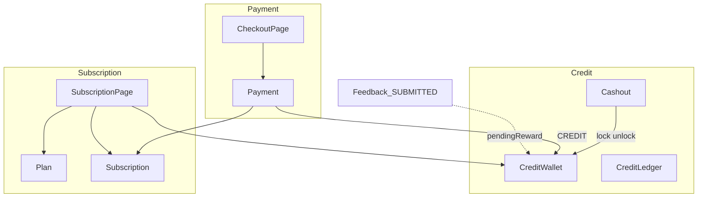
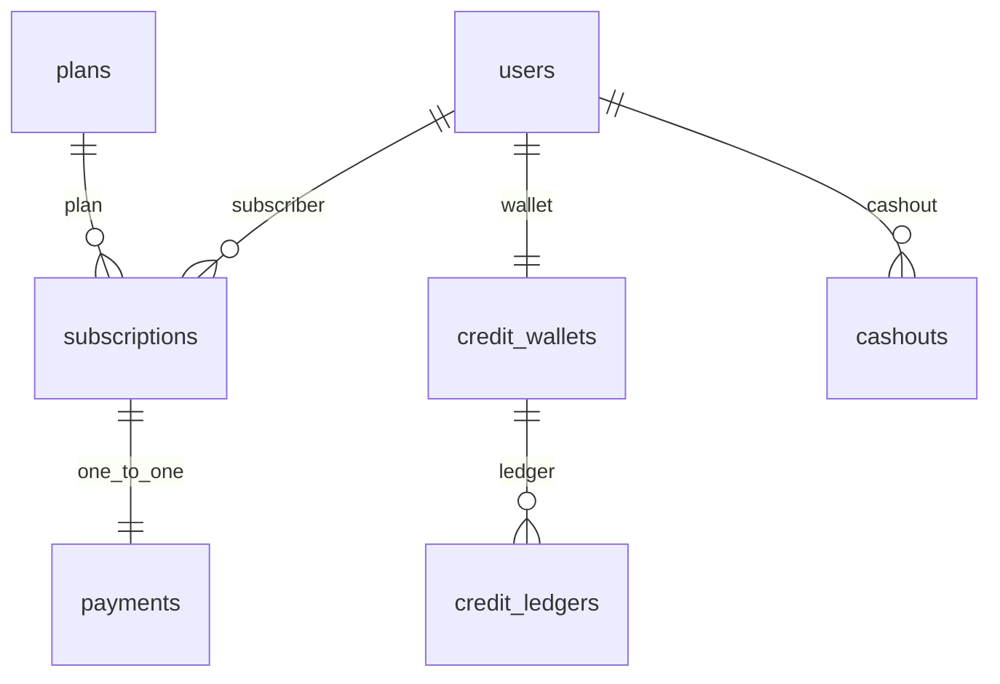

# 백엔드 결제·구독·크레딧

크레딧 잔액·내역·출금, 구독 상태, 구독 결제(시작/연장)의 백엔드 계획. 서버가 이 값들의 진실 공급원이 되고, `/my/subscription`·`/my/subscription/checkout`·`/my/credits`·`/admin/withdrawals`에 필요한 데이터를 API로 조립한다. 여러 이슈에 걸친 결정과 데이터 구조는 이 문서에 두고, 이슈별 계획은 이 폴더의 `<기능>.md`로 나눈다.

시나리오 제목 끝의 태그가 확인 방법이다. `[테스트]`만 이 문서 시나리오와 백엔드 테스트가 1:1이고, `[테스트: 파일 번호]`는 **다른** 테스트가 대신 확인할 때 쓴다(예: `credits.spec.ts S352`). `[명령]`은 명령 한 번, `[직접]`은 사람이 API·화면·코드로 확인한다.

## 이슈와 문서

| 이슈 | 내용 | 문서 |
| --- | --- | --- |
| [#45](https://github.com/likelion-backendschool-9th/test-moa/issues/45) | 결제·구독·크레딧 엔티티 | [entities.md](entities.md) |
| [#66](https://github.com/likelion-backendschool-9th/test-moa/issues/66) | 크레딧 잔액·내역 조회 API | [credit-balance-ledger.md](credit-balance-ledger.md) |
| [#67](https://github.com/likelion-backendschool-9th/test-moa/issues/67) | 출금 신청·내역 API | [cashout.md](cashout.md) |
| [#69](https://github.com/likelion-backendschool-9th/test-moa/issues/69) | 구독 플랜·내 구독 상태 API | [subscription.md](subscription.md) |
| [#70](https://github.com/likelion-backendschool-9th/test-moa/issues/70) | 구독 결제 화면 조회 API | [subscription-checkout.md](subscription-checkout.md) |
| [#71](https://github.com/likelion-backendschool-9th/test-moa/issues/71) | 구독 결제 실행 API | [subscription-payment.md](subscription-payment.md) |
| [#203](https://github.com/likelion-backendschool-9th/test-moa/issues/203) | 무료 플랜 조건 API(+ 구독 화면 프론트 연결) | [free-plan.md](free-plan.md) |
| [#68](https://github.com/likelion-backendschool-9th/test-moa/issues/68) | 운영자 출금 목록·지급·반려 API | [admin-cashout.md](admin-cashout.md) |

진행 순서는 크레딧(#66·#67) → 구독(#69) → 결제(#70·#71)다. 운영자 출금(#68)은 크레딧 다음이면 언제 해도 된다. 진행 상태는 이슈와 PR에서 본다.

프론트: [크레딧](../../frontend/payment/credits.md), [크레딧 구분·내역 시각](../../frontend/payment/credit-labels.md), [구독](../../frontend/payment/subscription.md), [출금 요청 관리](../../frontend/admin/withdrawals.md)

## 정한 것
- 프론트 목업의 규칙을 백엔드가 갖게 한다. 크레딧 조회·출금은 토큰의 회원만 본다(`/api/v1/my/credits`). 구독 API는 만들 때 같은 방식으로 맞춘다.
- **DB는 지금 ERD보다 복잡하게 만들지 않는다.** 테이블을 늘리지 않고, 컬럼도 꼭 필요한 것(`reject_memo`)만 더한다.
- **조건이 붙는 규칙은 DB가 아니라 백엔드가 맡는다.**

| 어디서 | 무엇을 |
| --- | --- |
| 요청 DTO | 값 하나만 보면 되는 검사(정해진 값인지, 길이 상한, 계좌번호 숫자 10~14자리) |
| 엔티티 메서드 | 상태 전이와 값끼리의 규칙(`pay()`, `reject()`, 지갑 `lockForCashout()` 등). setter는 두지 않는다 |
| 서비스 | 다른 테이블까지 보는 규칙(이미 처리된 요청인지, 결제 순서와 행 잠금, 장부 기록) |

| 도메인 | 책임 | 화면 |
| --- | --- | --- |
| 크레딧 | 잔액, 장부, 출금 | `/my/credits`, `/admin/withdrawals` |
| 구독 | 플랜·상태·페이지 조립 | `/my/subscription` |
| 결제 | checkout 조회·실행 | `/my/subscription/checkout` |

- 승인 대기 보상은 wallet 컬럼이 아니다. `Feedback(SUBMITTED)`가 있고 `Feedback(REPORTED)`가 없는 `Register` 스냅샷을 참가당 1회 합산한다. 상세는 [credit-balance-ledger.md](credit-balance-ledger.md).
- 구독 중인지는 날짜로 판단하고, 만료로 바꾸는 배치는 두지 않는다. 구독 상태는 `ACTIVE`·`CANCELLED` 둘만 있고 `EXPIRED`는 enum에서 뺐다. 규칙과 예는 [entities.md](entities.md#6-내-구독-45-r6)에 있다. (2026-11-07)
- 무료 플랜은 `plans`가 아니라 별도 테이블 `free_plans`(행 하나, 고정 PK)에 두고, 조회 `GET /api/v1/plans/free`와 운영자 저장 `PUT /api/v1/admin/plans/free`를 둔다. `plans`에 넣으면 구독 상품 목록에 섞여 결제 대상이 되기 때문이다. 행이 없으면 빈 혜택을 200으로 준다. ([free-plan.md](free-plan.md), #203, 2026-11-09)
- 모집 한도는 없다. `Plan.monthlyRecruitLimit`을 지웠고 구독 API에 한도·사용량이 없다. (#69, 2026-11-07)
- `Plan.tier`는 `String`으로 두고, 유료 등급이 늘어 코드가 등급 이름으로 갈라질 때 `enum`을 더한다. (#69, 2026-11-07)
- 지갑은 결제할 때 없으면 만든다. 회원가입 코드가 지갑을 만들지 않아서, 구독 결제(#71)가 "없을 때만 넣는" SQL로 지갑을 만든 뒤 그 행을 잠근다. 가입할 때 만드는 일은 인증 담당 코드라 이 이슈에서 하지 않는다. ([subscription-payment.md](subscription-payment.md), #71, 2026-11-08)
- 구독 결제는 직전 결제 후 5초 안이면 거절한다(409 `DUPLICATE_PAYMENT`). 더블클릭 방지이고 지갑 행을 잠근 채로 확인한다. ([subscription-payment.md](subscription-payment.md), #71, 2026-11-08)
- 출금 계좌번호·예금주는 **A 컬럼 암호화**(JPA `AttributeConverter` + AES-GCM, 키는 env). 응답 마스킹은 대기=전체, 완료=계좌 끝 4자리·예금주 가운데 가림. (#67, 2026-11-06)

#45에서 엔티티에 정한 것(자세한 규칙과 시나리오는 [entities.md](entities.md)):

| # | 대상 | 정한 것 |
| --- | --- | --- |
| 1 | `Cashout` | 계좌·예금주, 반려 사유 enum, `reject_memo`, `pay()`·`reject()` |
| 2 | `CashoutStatus` | `COMPLETED` 제거 |
| 3 | `CreditType` | `LOCKED` 제거 |
| 4 | `Payment` ↔ `Subscription` | 구독 1 : 결제 1 |
| 5 | `CreditLedger` | 결제 ID 없이 변동량만 |
| 6 | `CreditWallet` | 적립에 잠긴 금액 미포함. setter 없이 메서드만 |
| 7 | `Plan` | 조건 변경 시 새 행·version↑. 무료는 `plans`의 행으로 두지 않음(`free_plans`는 #203). `(tier, version)` unique |

## 데이터 구조

| 테이블 | 한 행이 뜻하는 것 | 자세히 |
| --- | --- | --- |
| `credit_wallets` | 회원 한 명의 지갑(이벤트·적립·잠긴 잔액) | [entities.md 1](entities.md#1-잔액-45-r1) |
| `credit_ledgers` | 총잔액이 실제로 바뀐 일 하나 | [entities.md 2](entities.md#2-크레딧-내역-45-r2) |
| `cashouts` | 출금 신청 하나 | [entities.md 3](entities.md#3-출금-신청내역-45-r3) |
| `plans` | 한 등급의 한 버전 조건 | [entities.md 5](entities.md#5-플랜-45-r5) |
| `free_plans` | 무료 플랜의 이름·혜택(행 하나) | [free-plan.md](free-plan.md) |
| `subscriptions` | 결제 한 번으로 산 이용 기간 하나 | [entities.md 6](entities.md#6-내-구독-45-r6) |
| `payments` | 구독 결제 한 번 | [entities.md 7](entities.md#7-구독-결제-45-r7) |

모든 엔티티에 `created_at`·`updated_at`이 있어 표에서는 뺐다.

## API 이슈
기능 문서를 만들기 전까지 API 이슈의 시나리오는 여기 둔다. 이슈를 시작할 때 `<기능>.md`로 옮긴다.

### #66 크레딧 잔액·내역 조회

시나리오·승인 대기 규칙은 [credit-balance-ledger.md](credit-balance-ledger.md)에 있다.

#66-S1 잔액 조회 API [직접]
- API: `GET /api/v1/my/credits`
- Then  `earnedBalance`, `eventCredit`, `lockedBalance`, `pendingReward`, `totalCredits`, `payableCredits`, `cashableCredits`
- 화면: `/my`, `/my/credits` (`docs/frontend/payment/credits.md` S350은 [직접]/[테스트] 해당 문서 기준)

#66-S2 내역 조회 API [직접]
- API: `GET /api/v1/my/credits/ledger?type=all|in|out`
- Then  `in`은 delta>0, `out`은 delta<0. 잘못된 type은 400
- Then  구독 결제는 EVENT/EARNED 행을 두 줄로 응답한다 (프론트 연동 때 한 줄 목업을 고침)
- 화면: `/my/credits` (`docs/frontend/payment/credits.md` S352~)

지급·차감 포트(다른 도메인이 지갑을 바꿀 때 부르는 메서드). 지갑 값과 장부 행은 항상 같이 바꾼다:

| 메서드 | 동작 | 호출하는 코드 |
| --- | --- | --- |
| `grantEvent` | `wallet.grantEvent` + 장부 EVENT | 아직 없음 |
| `grantEarned` | `wallet.grantEarned` + 장부 EARNED | 아직 없음(보상 지급 이슈에서 만든다) |
| `spendForSubscription` | `wallet.spendForSubscription` 후 `SpendResult`로 장부 행 | 구독 결제 `PaymentServiceImpl`(#71) |

### #67 출금 신청·내역

시나리오·계좌 암호화(A)·신청 트랜잭션은 [cashout.md](cashout.md)에 있다.

#67-S1 출금 내역 조회 [직접]
- API: `GET /api/v1/my/credits/withdrawals`
- Then  처리 중·지급 완료·반려. 반려는 사유와 메모(있으면) 포함
- 화면: `/my/credits/withdrawals` (`docs/frontend/payment/credits.md` S358~)

#67-S2 출금 신청 API [테스트: cashout.md #67-S2]
- API: `POST /api/v1/my/credits/withdrawals`
- Then  `Cashout(REQUESTED)` + `lockForCashout`. 자세한 시나리오는 [cashout.md](cashout.md)

### #68 운영자 출금

시나리오·API·처리 트랜잭션은 [admin-cashout.md](admin-cashout.md)에 있다. 화면: `/admin/withdrawals` ([withdrawals.md](../../frontend/admin/withdrawals.md))

### #69 구독 플랜·내 구독 상태

시나리오·API·규칙은 [subscription.md](subscription.md)에 있다. 화면: `/my/subscription` ([subscription.md](../../frontend/payment/subscription.md))

### #70 구독 결제 화면 조회

시나리오·API·규칙은 [subscription-checkout.md](subscription-checkout.md)에 있다. 화면: `/my/subscription/checkout` ([subscription.md](../../frontend/payment/subscription.md))

### #71 구독 결제 실행

시나리오·API·규칙·지갑 행 잠금은 [subscription-payment.md](subscription-payment.md)에 있다. 화면: `/my/subscription/checkout` ([subscription.md](../../frontend/payment/subscription.md))

### #203 무료 플랜 조건

시나리오·API·규칙은 [free-plan.md](free-plan.md)에 있다. 화면: `/subscription`의 FREE 카드 ([subscription-intro.md](../../frontend/payment/subscription-intro.md))

## 범위 밖
- 실제 PG·송금·실명 확인
- 구독 해지·환불 처리, 공개 요금제 페이지
- 프론트 목업 제거·API 연동 완료(계약 안정 후)
- 인증 본구현
- 피드백 72시간 자동 지급 스케줄러, 이번 달 모집 사용량 집계(프로젝트 도메인)

## 가정
- API 필드: `eventCredit`, `earnedBalance`, `lockedBalance`. 인증 전 `userId` 경로.
- 목업 쿠키 제거는 연동 PR에서 한다. 크레딧 내역의 구독 결제는 연동 때 두 줄 기준.

## 아직 정하지 않은 것

| # | 무엇을 | 고를 것 |
| --- | --- | --- |
| 1 | 미리 결제 가능 기간 | 제한 없음 / 상한(예: 남은 기간 1년) |

계좌번호·예금주 저장은 **A 컬럼 암호화**로 정했다 (#67, [cashout.md](cashout.md)). 응답 마스킹은 대기=전체, 완료=계좌 끝 4자리·예금주 가운데 가림이다.

- ERD와 코드의 테이블·PK 이름(단수/복수, `id` vs `*_id`)을 맞추는 일. ERD 그림에서는 payment와 subscription 사이를 **1:1**로 그리고 값 설명만 고치면 된다.
