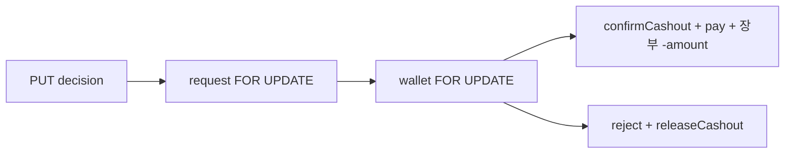

# 백엔드 운영자 출금 처리

시나리오 제목 끝의 태그가 확인 방법이다. `[테스트]`만 이 문서 시나리오와 백엔드 테스트가 1:1이고, `[직접]`은 사람이 API·화면·코드로 확인한다.

이슈: [#68](https://github.com/likelion-backendschool-9th/test-moa/issues/68). 요구·시나리오는 `#68-S…`부터 센다. 번호가 `#68-S11` 이후인 것은 운영자 화면(목업) 시나리오이고 [withdrawals.md](../../frontend/admin/withdrawals.md)에 있다. 엔티티는 [entities.md](entities.md), 신청·내역·마스킹은 [cashout.md](cashout.md), 도메인 결정은 [README.md](README.md).

## 한눈에
- 끝나면: 운영자가 출금 요청 목록(처리 대기·처리 완료)과 상세를 보고, 지급 완료나 반려로 처리한다. 처리 결과는 서버가 갖는다.
- 선행: #67 (`Cashout`, 지갑 `confirmCashout`·`releaseCashout`, 마스킹, 지갑 행 잠금).
- 화면: `/admin/withdrawals`, `/admin/withdrawals?open=:withdrawalKey` — [withdrawals.md](../../frontend/admin/withdrawals.md)
- 프론트 목업 제거와 API 연동은 이 이슈 범위 밖이다. 운영자 화면은 문구·라벨만 이 이슈에서 맞춘다(아래 "화면에서 함께 맞출 것").

## 정한 것 (#68, 2026-11-06)
- **반려 메모는 사유와 상관없이 회원에게 그대로 보인다.** 사유 라벨은 고정 문구이고, 메모는 `OTHER`만 필수, 나머지는 선택이다. 운영자 전용 메모 칸은 없다. 필요해지면 그때 필드를 나눈다. (README의 #67 결정과 같다)
- 지급 완료에는 메모를 받지 않는다.
- 처리한 요청은 되돌릴 수 없다. 송금 실패 뒤 되돌리기는 정하지 않았다.

## API

경로는 팀 API 표를 따라 `/api/v1/admin/withdrawals`이고, `SecurityConfig`가 `ADMIN`만 허용한다(`/api/v1/admin/**`). 컨트롤러는 `controller/admin/CashoutController`로 새로 만든다. 경로의 `{withdrawalKey}`는 출금 요청의 `id`다.

| 메서드 | 경로 | 설명 |
| --- | --- | --- |
| `GET` | `/api/v1/admin/withdrawals?tab=pending\|done` | 목록. `tab` 기본값은 `pending` |
| `GET` | `/api/v1/admin/withdrawals/{withdrawalKey}` | 상세 |
| `PUT` | `/api/v1/admin/withdrawals/{withdrawalKey}` | 처리(지급 완료·반려). 본문의 `decision`으로 가른다 |

### 처리 요청 본문

| 필드 | 규칙 |
| --- | --- |
| `decision` | 필수. `PAID`(지급 완료) 또는 `REJECTED`(반려). `REQUESTED`나 빈 값은 400 |
| `reason` | 반려(`REJECTED`)일 때 필수. `HOLDER` / `ACCOUNT` / `OTHER`. 지급에 보내면 400 |
| `memo` | 선택. 지급에 비어 있지 않은 값을 보내면 400. `reason`이 `OTHER`면 공백 제외 1자 이상 필수. 80자까지(프론트와 같게). 회원에게 그대로 보인다 |

형식(결정 필수·80자)은 DTO가, 지급에 사유·메모를 보냈는지와 `REQUESTED` 결정은 서비스 `process()`가, 반려의 사유 필수·`OTHER`면 메모 필수는 엔티티 `reject()`가 본다. `reject()`가 던지는 `IllegalArgumentException`은 서비스가 `BusinessException(INVALID_INPUT)`으로 바꿔 400으로 내린다.

### 응답 한 줄

목록·상세·처리 응답이 같은 모양이다.

| 필드 | 의미 |
| --- | --- |
| `id` | 요청 id |
| `nickname`, `userName` | 요청자 닉네임, 가입 실명. 화면의 "예금주 확인 필요" 표시에 쓴다 |
| `amount` | 금액 |
| `status` | `REQUESTED` / `PAID` / `REJECTED` |
| `bank`, `accountNumber`, `accountHolder` | `REQUESTED`는 전체, 완료는 끝 4자리·가운데 가림 ([cashout.md](cashout.md)의 마스킹 규칙 그대로, `Masking`) |
| `rejectReason`, `rejectMemo` | 반려일 때만. 회원 응답과 같은 값이다 |
| `requestedAt`, `processedAt` | 신청·처리 시각 |

### 정렬
- `pending`: 신청이 오래된 순 (`createdAt` 오름차순).
- `done`: 최근 처리 순 (`processedAt` 내림차순).
- 페이지 나누기는 하지 않는다 (화면 계획의 범위 밖과 같다).

---

## 처리 트랜잭션

한 요청을 두 번 처리하거나, 지급과 반려가 동시에 들어와도 한쪽만 적용되어야 한다. 잠금 순서는 **요청 행 → 지갑 행**으로 고정한다. 신청(#67)은 지갑 행만 잠그므로 순서가 엇갈려 교착이 생기지 않는다.

**지급 (`pay`)**
1. 요청 행을 `PESSIMISTIC_WRITE`로 읽는다 (`findByIdForUpdate`). 없으면 `NOT_FOUND`
2. 상태가 `REQUESTED`가 아니면 `CASHOUT_ALREADY_PROCESSED`(409)
3. 요청자의 지갑 행을 `findLockedByUserId`로 잠근다
4. `wallet.confirmCashout(amount)` — 잠김만 줄어든다
5. `request.pay(now)`
6. 장부 한 줄: `EARNED`, `delta = -amount`, 설명 "출금 지급"
7. 커밋

**반려 (`reject`)**
1~3. 지급과 같다
4. `request.reject(reason, memo, now)` — 상태·사유·메모를 먼저 검사한다. `OTHER`에 메모가 없으면 `IllegalArgumentException`이라 400이고 전부 롤백한다
5. `wallet.releaseCashout(amount)` — 잠김 → 적립
6. 장부는 남기지 않는다
7. 커밋

실패하면 전부 롤백한다. 새 에러 코드는 `CASHOUT_ALREADY_PROCESSED(CONFLICT, "이미 처리한 출금 요청이에요")` 하나다.

---

## 시나리오

이슈 본문 조건을 `#68-S…`로 옮긴다.

#68-S1 지급 완료 [테스트]
- Given 잠김 5,000인 `REQUESTED` 요청 5,000
- When  `PUT …/{withdrawalKey}` `decision=PAID`
- Then  상태 `PAID`, 처리 시각이 있다. 잠김 0, 적립 그대로, 총잔액에서 5,000이 빠진다
- Then  장부에 `EARNED` −5,000 "출금 지급" 한 줄이 남는다

#68-S2 반려 [테스트]
- Given 잠김 5,000인 `REQUESTED` 요청 5,000
- When  `PUT …/{withdrawalKey}` `decision=REJECTED` `reason=ACCOUNT`
- Then  상태 `REJECTED`, 사유가 저장된다. 잠김 0, 적립 +5,000
- Then  장부 행이 없다

#68-S3 이미 처리한 요청은 다시 처리할 수 없다 [테스트]
- Given `PAID` 요청과 `REJECTED` 요청
- When  각각 지급 또는 반려로 `PUT`
- Then  409 `CASHOUT_ALREADY_PROCESSED`. 지갑·장부 변화 없음

#68-S4 반려 사유와 메모 규칙 [테스트]
- When  `reason` 없이 반려한다
- Then  400
- When  `OTHER`에 메모가 없거나 공백이다
- Then  400. 요청과 지갑 변화 없음
- When  `HOLDER`에 메모 "통장 사본의 이름과 달라요"로 반려한다
- Then  처리된다. 상세 응답의 `rejectMemo`가 그 메모이고, 회원 출금 내역(#67-S6)에도 같은 메모가 보인다

#68-S5 목록 정렬 [테스트]
- Given 대기 3건(신청 시각이 다름)과 완료 2건(처리 시각이 다름)
- When  `tab=pending`, `tab=done`
- Then  대기는 신청이 오래된 순, 완료는 최근 처리 순이다
- When  `tab`이 `pending`·`done`이 아니다
- Then  400

#68-S6 계좌 마스킹 [테스트]
- Given 대기 요청과 완료 요청
- When  상세와 목록을 읽는다
- Then  대기 건은 계좌번호·예금주 전체, 완료 건은 계좌 끝 4자리·예금주 가운데 가림이다 (목록과 상세, 처리 응답이 같다)

#68-S7 운영자가 아니면 모두 막힌다 [테스트]
- When  토큰 없이 목록·상세·처리를 부른다
- Then  401
- When  일반 회원 토큰으로 부른다
- Then  403. 요청과 지갑 변화 없음

#68-S8 없는 요청 [테스트]
- When  없는 id로 상세·`PUT`
- Then  404

#68-S9 같은 요청을 동시에 처리하면 한쪽만 적용된다 [테스트]
- Given `REQUESTED` 요청 하나
- When  지급과 반려를 거의 동시에 보낸다
- Then  하나는 성공, 하나는 409. 잠김이 음수가 되거나 적립이 두 번 늘지 않는다 (요청 행 잠금)

#68-S10 운영자 API 전체 흐름 [직접]
- API: 위 표의 네 개
- Then  신청(#67) → 목록(대기) → 지급 또는 반려 → 목록(완료) → 회원 내역(`GET /api/v1/my/credits/withdrawals`)이 이어진다

#68-S14 처리는 PUT 하나로, 결정에 따라 지급·반려한다 [테스트]
- When  `decision=PAID`로 `PUT`한다
- Then  지급된다(S1과 같음)
- When  `decision=REJECTED`와 사유·메모로 `PUT`한다
- Then  반려된다(S2·S4와 같음)
- When  `decision`이 없거나 `REQUESTED`이거나, 지급에 사유나 메모를 붙여 `PUT`한다
- Then  400. 요청과 지갑 변화 없음

---

## 화면에서 함께 맞출 것 (#68-S11~)

반려 메모가 모든 사유에서 회원에게 보이게 바뀌었으므로, 운영자 화면 목업의 안내 문구·라벨·e2e를 같은 규칙으로 맞춘다. 시나리오는 [withdrawals.md](../../frontend/admin/withdrawals.md)의 `#68-S11`~`#68-S13`과 S208·S218 수정이다. 화면은 계속 목업이고, API 연동은 이 이슈 범위 밖이다.

---

## 구현 메모
- `CashoutRepository`: `findByIdForUpdate`(`@Lock(PESSIMISTIC_WRITE)`), `findByStatusOrderByCreatedAtAsc`, `findByStatusInOrderByProcessedAtDesc`. 목록은 `user`를 함께 읽어(`fetch join`) N+1을 피한다
- 서비스: `CashoutService`(목록·상세·`process`). `process`가 결정에 따라 `pay`나 `reject`를 부른다. 읽기 전용 트랜잭션과 쓰기 트랜잭션을 나누고, `process`는 쓰기 트랜잭션이다(같은 클래스 안에서 부르는 `pay`·`reject`가 읽기 전용에 걸리지 않게)
- 가리는 일은 서비스가 `Masking`(`global/util`)으로 한다. 응답 DTO `AdminCashoutResponse`는 가려진 값을 받아 담고, 닉네임·실명을 더한다
- 단위 테스트: S1~S6·S8은 서비스, S7은 컨트롤러 인증 테스트(`CreditControllerAuthTest`와 같은 방식), S9는 동시성 테스트(`CashoutConcurrencyTest`와 같은 방식)
- 테스트 DB가 필요하다. 로컬 Postgres가 꺼져 있으면 컨텍스트 테스트가 실패한다

## 범위 밖
- 프론트 목업 제거·API 연동
- 실제 송금·실명 확인·PG
- 처리 취소, 송금 실패 처리
- 여러 건 한꺼번에 처리, 기간·금액 검색, 페이지 나누기
- 처리 결과 알림
- 운영자 전용 메모 칸 (필요해지면 필드를 나눈다)

## 작업 순서
1. 운영자 화면의 안내 문구·라벨·e2e (프론트, [withdrawals.md](../../frontend/admin/withdrawals.md))
2. Repository 메서드·에러 코드·응답 DTO
3. 목록·상세 API + 테스트 (S5·S6·S7·S8)
4. 지급·반려 API + 테스트 (S1~S4)
5. 동시성 테스트 (S9)
6. 문서 정리

## 가정
- `Cashout.pay()`·`reject()`와 지갑 `confirmCashout()`·`releaseCashout()`은 #45·#67에 있다.
- `ADMIN`만 `/api/v1/admin/**`에 들어올 수 있는 규칙은 `SecurityConfig`에 있다.
