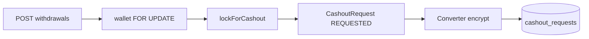

# 백엔드 출금 신청·내역

시나리오 제목 끝의 태그가 확인 방법이다. `[테스트]`만 이 문서 시나리오와 백엔드 테스트가 1:1이고, `[직접]`은 사람이 API·화면·코드로 확인한다.

이슈: `#67`. 요구·시나리오는 `#67-R…`, `#67-S…`부터 센다. 엔티티는 [entities.md](entities.md). 잔액 조회는 [credit-balance-ledger.md](credit-balance-ledger.md). 도메인 결정은 [README.md](README.md).

## 한눈에
- 끝나면: 회원이 금액·계좌로 출금을 신청하고, 내 출금 내역(처리 중·지급 완료·반려)을 본다. 신청 시 적립→잠김만 옮기고 장부는 없다. 프론트 목업 제거는 이후 별 PR.
- 인증은 토큰의 회원 id다 (#66과 같음). 경로는 `/api/v1/my/credits`.
- 선행: #66 (지갑·`cashable`·예외 패턴).
- 화면: `/my/credits/withdrawals` — [credits.md](../../frontend/payment/credits.md)

## API

| 메서드 | 경로 | 설명 |
| --- | --- | --- |
| `GET` | `/api/v1/my/credits/withdrawals` | 내 출금 내역. 최신순. 로그인 필요 |
| `POST` | `/api/v1/my/credits/withdrawals` | 출금 신청 |

컨트롤러는 `#66`의 `CreditController`에 메서드를 더하거나, 같은 `/credits` 아래 `CashoutController`로 나눈다. 경로는 위와 같다.

### 신청 요청 본문

| 필드 | 규칙 |
| --- | --- |
| `amount` | 정수. 1 이상이고 `cashable()` 이하 |
| `bank` | 비어 있지 않음. 프론트 은행 목록과 같은 허용 값 |
| `accountNumber` | 숫자만 10~14자리 |
| `accountHolder` | 비어 있지 않음. 길이 상한은 DTO에서 |

이벤트 크레딧은 출금 불가(`cashable()` = `earnedBalance`만).

### 내역 응답 한 줄

| 필드 | 의미 |
| --- | --- |
| `id` | 요청 id |
| `amount` | 신청 금액 |
| `status` | `REQUESTED` / `PAID` / `REJECTED` (화면: 처리 중·지급 완료·반려) |
| `bank` | 은행 |
| `accountNumber` | 마스킹 규칙 아래 |
| `accountHolder` | 예금주. 마스킹 규칙은 아래 |
| `rejectReason` | 반려일 때만. `OTHER`면 `rejectMemo`를 회원에게 보이는 사유로 |
| `rejectMemo` | 회원 응답에서는 `OTHER`일 때만. HOLDER/ACCOUNT 운영자 메모는 null |
| `requestedAt` | 신청 시각 (`createdAt`) |
| `processedAt` | 처리 시각. 미처리면 null |

**계좌·예금주 마스킹 (응답):**
- `REQUESTED`(처리 중): 계좌번호·예금주 **전체**
- `PAID`·`REJECTED`(완료): 계좌번호는 **끝 4자리**만. 예금주는 앞·뒤 글자만 남긴다(두 글자는 앞 글자만, 한 글자는 `*`). 예: `한서윤` → `한*윤`, `김철` → `김*`

운영자 목록(#68)도 같은 마스킹 규칙을 쓴다. 대기 건만 전체.

---

## 계좌 저장: A 컬럼 암호화 (정함 #67)

[README.md](README.md)에서 A로 정했다.

| 항목 | 내용 |
| --- | --- |
| 대상 | `accountNumber`. 예금주(`accountHolder`)도 개인 정보라 **같이 암호화**한다 |
| 방식 | JPA `AttributeConverter`. AES-GCM. 행마다 IV를 두고 암호문에 붙인다 |
| 키 | 환경 변수 `CASHOUT_ACCOUNT_CRYPTO_KEY` (Base64 32바이트 AES-256). 코드·Git에 넣지 않는다 |
| 컬럼 | 암호문이 더 기므로 `length`를 넉넉히 (예: 255). 테이블·컬럼을 새로 늘리지는 않는다 |
| 검색 | 암호문이라 계좌번호 LIKE·정렬 불가 |
| 로컬·CI | 테스트용 고정 키. 키 없으면 기동 실패가 안전 |
| 응답 | 암호화와 별개로 **위 마스킹**을 유지한다. 엔티티에는 복호화된 평문, DTO에서 가린다 |

키 로테이션·KMS는 범위 밖. 키를 바꾸면 기존 행을 못 읽는다.

---

## 신청 트랜잭션

동시에 두 번 신청해도 `cashable`보다 많이 잠기지 않게 한다 (#67 이슈 시나리오 5).

1. 사용자 확인 (`BusinessException` `NOT_FOUND`)
2. 지갑 행을 `PESSIMISTIC_WRITE`로 잠근다 (`findByUserIdForUpdate` — #71 결제와 같은 방식. #66에 없으면 #67에서 추가)
3. 요청 값 검증 (DTO + `cashable()` 부족·금액 1 미만)
4. `wallet.lockForCashout(amount)` — 장부 행 없음
5. `CashoutRequest` 생성 (`REQUESTED`)
6. 커밋

실패 시 전부 롤백. 장부에는 신청·반려가 안 남고, 지급(#68) 때만 `EARNED` −amount가 남는다 ([entities.md](entities.md)).

---

## 시나리오

이슈 본문 조건을 `#67-S…`로 옮긴다.

#67-S1 출금 내역 조회 [직접]
- API: `GET /api/v1/my/credits/withdrawals`
- Then  최신순. 처리 중·지급 완료·반려
- Then  반려는 사유 포함. `OTHER`면 메모가 회원에게 보이는 사유
- Then  `REQUESTED`는 계좌·예금주 전체, `PAID`·`REJECTED`는 계좌 끝 4자리·예금주 가운데 가림 (고침 #67: 완료 건 예금주도 가린다)
- 화면: `/my/credits/withdrawals`

#67-S2 출금 신청 성공 [테스트]
- Given 적립 `cashable` 9,480
- When  `POST` amount 5,000 · 은행·계좌·예금주 유효
- Then  `CashoutRequest(REQUESTED)`, 적립 4,480 · 잠김 5,000, 장부 행 없음
- Then  DB의 `account_number`·`account_holder`는 평문이 아니다 (암호문)

#67-S3 신청 검증 실패 [테스트]
- When  금액이 `cashable`보다 크거나 1 미만이거나, 계좌가 숫자 10~14자리가 아님
- Then  `BusinessException`(`INVALID_INPUT` 등). 지갑·출금 행 변화 없음

#67-S4 이벤트 크레딧만 있으면 출금 불가 [테스트]
- Given 이벤트만 있고 적립 0
- When  출금 신청
- Then  거절. 잠김 증가 없음

#67-S5 동시 신청이 잔액을 넘지 않음 [테스트]
- Given 적립 5,000
- When  같은 사용자가 5,000씩 두 요청을 거의 동시에
- Then  성공은 하나뿐이거나, 합친 잠김이 5,000을 넘지 않는다 (지갑 행 잠금)

#67-S6 내역 상태·반려 사유 [직접]
- Given `REQUESTED`·`PAID`·`REJECTED(OTHER)` 행
- When  내역 조회
- Then  상태 라벨과 OTHER 메모가 보인다. 완료 건 계좌는 마스킹

#67-S7 토큰 없이 출금 내역을 보면 401 [테스트]
- When  토큰 없이 `GET /api/v1/my/credits/withdrawals`
- Then  401이다

---

## 구현 메모
- Repository: `CashoutRequestRepository` (userId 최신순), `CreditWalletRepository.findByUserIdForUpdate`
- Service: 신청·목록. 예외는 `BusinessException` (#66과 동일)
- Converter + 키 설정. `.env.example`·`application-local` 예시·CI 테스트 키
- 은행 허용 목록은 프론트 `BANKS`와 맞춤
- 단위 테스트: Converter 암·복호화, #67-S2~S5·S7. S1·S6은 [직접] 또는 MockMvc

## 범위 밖
- 운영자 지급·반려·장부 (#68)
- 실제 송금·실명 확인·PG
- 프론트 목업 제거·API 연동
- 키 로테이션·KMS
- 처리 후 계좌 파기(C안)

## 작업 순서
1. 암호화 Converter·키 설정·컬럼 length
2. Repository·지갑 FOR UPDATE
3. 신청 API + 테스트
4. 내역 API + 마스킹
5. 문서·`.env.example` 정리

## 가정
- `CashoutRequest`·`CashoutStatus`·`lockForCashout`는 #45에 있다
