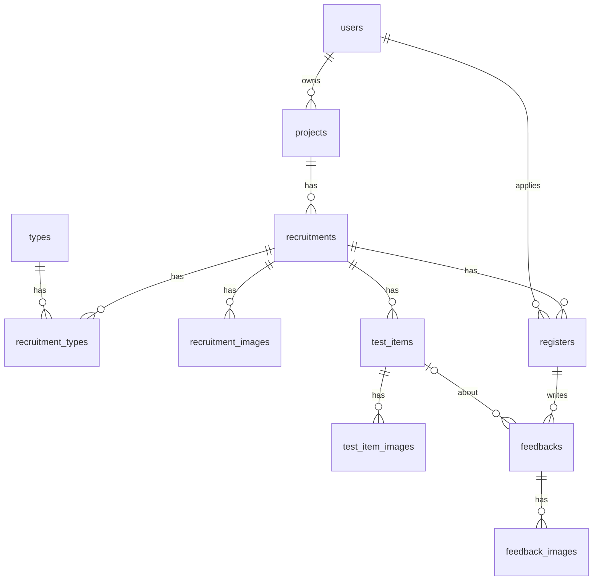

# 백엔드 프로젝트·테스터·피드백

시나리오 제목 끝의 태그가 확인 방법이다. `[테스트]`는 백엔드 단위 테스트와 1:1이고(`@DisplayName("#89-S…")`), `[직접]`은 사람이 코드와 Hibernate가 만든 DDL로 확인한다.

이슈: 상위 `#34`, 엔티티 `#89`, 프로젝트·모집 작성 API `#92`. 요구·시나리오는 이슈마다 `#89-R1`, `#89-S1`처럼 1부터 센다.

## 한눈에
- 끝나면: 프로젝트 하나에 모집글 여러 개를 표현할 수 있고, 지원·확정·피드백의 상태 규칙을 엔티티가 지킨다. 보상액은 확정할 때 참가 정보에 고정된다.
- 지금 문제: `Project` 엔티티에 ERD `테스트 모집글`의 내용이 들어 있고, ERD `프로젝트`에 해당하는 엔티티가 없다.
- 이번 범위: 엔티티와 그 메서드, enum, 단위 테스트. Repository·Service·API는 다음 이슈에서 한다.
- 브랜치: `feature/backend-project-tester-feedback-entities`
- 프론트: `docs/frontend/projects.md`, `docs/frontend/participations.md`, `docs/frontend/recruitment-detail.md`

## 맥락
- `docs/backend/payment-subscription-credit.md`와 같은 기준을 쓴다. ERD보다 복잡하게 만들지 않고, 조건이 붙는 규칙은 백엔드가 맡는다.

| 어디서 | 무엇을 |
| --- | --- |
| 엔티티 메서드 | 상태 전이와 값끼리의 규칙. setter는 두지 않는다. 상태는 밖에서 받지 않고 메서드가 정한다 |
| 서비스(다음 이슈) | 다른 테이블까지 보는 규칙: 확정 테스터가 있는 모집의 취소 가능 여부, 선착순 자동 확정, 피드백 중복 제출, 필수 항목 누락 |

## 정한 것

| # | 결정 | 이유 |
| --- | --- | --- |
| 1 | 피드백은 테스트 항목별 행으로 저장하고 한 번에 제출한다 | ERD와 개발자 화면이 항목별이다. 같은 `submittedAt`을 넣어 72시간 기준을 하나로 둔다 |
| 2 | 보상 스냅샷은 `Register`에 둔다 | ERD와 같다. 확정할 때 금액을 고정할 수 있고, 피드백이 여러 행이어도 보상은 참가당 한 번이다 |
| 3 | `recruit_count`를 뺀다 | 팀에서 모집 인원을 아예 빼기로 했고 ERD에서도 지웠다. 화면은 #78에서 뺀다 |
| 4 | `Feedback.testItem`은 null을 허용한다 | ERD 내보내기는 `NOT NULL`이지만 기타 의견을 null로 표현한다 |
| 5 | `ProjectImage`는 `TestItemImage`로 이름을 바꾼다 | 프로젝트 이미지는 `projects.image_url`, 모집글 이미지는 `recruitment_images`가 맡아 테스트 항목 이미지만 남는다 |
| 6 | ERD에 `cancel_reason`, `cancelled_at`, `is_recommended`를 더한다 | 프론트 화면에 필요하고 ERD에 없다. 코드와 함께 ERD도 고친다 |
| 7 | 모집글의 주소 키로 slug를 저장하지 않는다 | ERD에 없다. API를 만들 때 프론트의 slug 자리에 `recruitment_id`를 넘긴다 |

## 이슈 #89 시나리오 확인

| 이슈 항목 | 시나리오 |
| --- | --- |
| 1 프로젝트 정보 저장 | #89-S1 |
| 2 프로젝트 하나에 모집글 여러 개 | #89-S2 |
| 3 유형과 이미지는 모집글에 연결 | #89-S3 |
| 4 모집 인원 없이 저장 | #89-S4 |
| 5 모집 취소 | #89-S5~S8 |
| 6 테스트 항목은 모집글에 연결, 필수·선택 | #89-S9 |
| 7 테스트 항목 이미지 | #89-S10 |
| 8 지원 | #89-S11 |
| 9 확정과 보상 고정 | #89-S12~S14 |
| 10 거절과 취소, 잘못된 변경 차단 | #89-S15~S17 |
| 11 항목별 작성, 한 번에 제출, 기타 의견 | #89-S18, #89-S19 |
| 12 피드백에 제목과 보상액 없음 | #89-S20 |
| 13 추천 | #89-S21 |
| 14 피드백 상태와 전이 | #89-S22~S25 |

---

## 1. 프로젝트와 모집글 (#89-R1)

### `projects` (새로 만듦)

| 필드 | 컬럼 | 타입 | null | 설명 |
| --- | --- | --- | --- | --- |
| `user` | `user_id` | FK → users | 불가 | 프로젝트 주인 |
| `title` | `title` | String | 불가 | 소프트웨어 이름 |
| `description` | `description` | TEXT | 가능 | 설명 |
| `imageUrl` | `image_url` | TEXT | 가능 | 대표 이미지 |

### `recruitments` (지금 `Project`에서 이름을 바꿈)

| 필드 | 컬럼 | 타입 | null | 설명 |
| --- | --- | --- | --- | --- |
| `project` | `project_id` | FK → projects | 불가 | `user` 대신 프로젝트를 가리킨다 |
| `title`, `description`, `conditions`, `accessUrl` | 같은 이름 | 지금과 같음 | 지금과 같음 | 그대로 옮긴다 |
| `recruitDeadline`, `feedbackDeadline` | 같은 이름 | LocalDateTime | 불가 | 그대로 옮긴다 |
| `status` | `status` | enum `RecruitmentStatus` | 불가 | `ProjectStatus`에서 이름을 바꿈. `RECRUITING`으로 시작 |
| `selectionMode` | `selection_mode` | enum `SelectionMode` | 불가 | 그대로 옮긴다 |
| `version` | `version` | Integer | 불가 | **추가.** 1로 시작 |
| `analysisStatus` | `analysis_status` | enum `AnalysisStatus` | 불가 | **추가.** `NONE`/`PENDING`/`DONE`/`FAILED`. `NONE`으로 시작 |
| `cancelReason` | `cancel_reason` | TEXT | 가능 | **추가.** 테스트 전 취소는 비어 있다 |
| `cancelledAt` | `cancelled_at` | LocalDateTime | 가능 | **추가** |

- `ProjectType` → `RecruitmentType`(`recruitment_types`): `project` 대신 `recruitment`를 가리킨다
- `RecruitmentImage`(`recruitment_images`, 새로 만듦): `recruitment`, `url`, `sortOrder`
- 메서드: `cancel(String reason, LocalDateTime cancelledAt)`
- 취소할 수 있는 시기와 사유가 필수인 경우는 확정 테스터와 일정을 함께 봐야 해서 서비스가 확인한다(`docs/frontend/projects.md` 모집 취소 표)

#89-S1 프로젝트에는 프로젝트 정보만 있다 [직접]
- `Project`에 `user`, `title`, `description`, `imageUrl`이 있고 모집 조건·일정은 없다

#89-S2 프로젝트 하나에 모집글 여러 개 [직접]
- DDL의 `recruitments.project_id`에 unique가 없고, 모집 조건·일정은 `recruitments`에 있다

#89-S3 유형과 이미지는 모집글에 연결 [직접]
- DDL의 `recruitment_types`, `recruitment_images`에 `recruitment_id`가 있다

#89-S4 모집 인원 없이 저장 [직접]
- DDL의 `recruitments`에 `recruit_count`가 없다

#89-S5 사유를 적고 취소 [테스트]
- Given `RECRUITING` 모집글
- When  `cancel("서버 장애", now)`
- Then  상태가 `CANCELLED`이고 사유와 취소 시각이 남는다

#89-S6 사유 없이 취소 [테스트]
- When  `cancel(null, now)`
- Then  상태가 `CANCELLED`이고 사유는 null이다

#89-S7 모집글 시작 값 [테스트]
- Given 새 모집글
- Then  상태 `RECRUITING`, 버전 1, 분석 상태 `NONE`, 취소 사유와 시각은 null이다

#89-S8 다시 취소할 수 없음 [테스트]
- Given `CANCELLED` 모집글
- When  `cancel`
- Then  `IllegalStateException`이고 처음 사유와 시각이 그대로다

---

## 2. 테스트 항목 (#89-R2)

- `TestItem`: `project` 대신 `recruitment`를 가리키고, `required`(`is_required`, boolean, null 불가)를 더한다
- `ProjectImage` → `TestItemImage`(`test_item_images`): `project`를 빼고 `testItem`을 필수로 둔다. `url`, `sortOrder`는 그대로다

#89-S9 테스트 항목은 모집글에 연결되고 필수 여부가 있다 [직접]
- DDL의 `test_items`에 `recruitment_id`와 `is_required`가 있고 `project_id`가 없다

#89-S10 이미지는 테스트 항목에 연결 [직접]
- DDL의 `test_item_images.test_item_id`에 `not null`이 있고 `project_id`가 없다

---

## 3. 지원과 참가 (#89-R3)

### `registers`

| 필드 | 컬럼 | 타입 | null | 설명 |
| --- | --- | --- | --- | --- |
| `recruitment` | `recruitment_id` | FK → recruitments | 불가 | `project` 대신 |
| `user` | `user_id` | FK → users | 불가 | 테스터 |
| `status` | `status` | enum `RegisterStatus` | 불가 | `APPLIED`를 더한다. `APPLIED`로 시작 |
| `appliedAt` | `applied_at` | LocalDateTime | 불가 | 지금과 같다 |
| `confirmedAt` | `confirmed_at` | LocalDateTime | 가능 | 확정 전에는 null |
| `baseRewardSnapshot` | `base_reward_snapshot` | Integer | 가능 | **`Feedback`에서 옮김.** 확정 전에는 null |
| `extraRewardSnapshot` | `extra_reward_snapshot` | Integer | 가능 | **`Feedback`에서 옮김.** 확정 전에는 null |

| 지금 상태 | `confirm` | `reject` | `cancel` |
| --- | --- | --- | --- |
| `APPLIED` | `CONFIRMED` | `REJECTED` | `CANCELLED` |
| `CONFIRMED` | 불가 | 불가 | `CANCELLED` |
| `REJECTED` | 불가 | 불가 | 불가 |
| `CANCELLED` | 불가 | 불가 | 불가 |

선착순 모집은 서비스가 지원을 저장한 뒤 바로 `confirm`을 부른다. 피드백을 낸 테스터를 모집 취소에서 제외하는 판단도 서비스가 한다.

#89-S11 지원 [테스트]
- Given 새 `Register`
- Then  상태 `APPLIED`, 확정 시각과 보상 스냅샷은 null이다

#89-S12 확정하면 보상액이 고정된다 [테스트]
- When  `confirm(1000, 300, now)`
- Then  상태 `CONFIRMED`, 확정 시각 now, 기본 1000, 추가 300이다

#89-S13 보상액이 없거나 음수면 확정할 수 없음 [테스트]
- When  `confirm(null, 300, now)` 또는 `confirm(1000, -1, now)`
- Then  `IllegalArgumentException`이고 상태는 `APPLIED`다

#89-S14 대기 중이 아니면 확정할 수 없음 [테스트]
- Given `CONFIRMED`, `REJECTED`, `CANCELLED`
- When  `confirm`
- Then  `IllegalStateException`이고 처음 보상액이 그대로다

#89-S15 거절 [테스트]
- Given `APPLIED`
- When  `reject()`
- Then  `REJECTED`다. `APPLIED`가 아니면 `IllegalStateException`이다

#89-S16 지원과 확정은 취소할 수 있음 [테스트]
- Given `APPLIED` 또는 `CONFIRMED`
- When  `cancel()`
- Then  `CANCELLED`다

#89-S17 거절과 취소는 다시 취소할 수 없음 [테스트]
- Given `REJECTED` 또는 `CANCELLED`
- When  `cancel()`
- Then  `IllegalStateException`이고 상태가 그대로다

---

## 4. 피드백 (#89-R4)

### `feedbacks`

| 필드 | 컬럼 | 타입 | null | 설명 |
| --- | --- | --- | --- | --- |
| `register` | `register_id` | FK → registers | 불가 | 그대로 |
| `testItem` | `test_item_id` | FK → test_items | 가능 | 기타 의견은 null |
| `content` | `content` | TEXT | 불가 | 그대로 |
| `submittedAt` | `submitted_at` | LocalDateTime | 불가 | 자동 기록 대신 서비스가 넘긴다. 한 번에 낸 피드백은 같은 값이다 |
| `status` | `status` | enum `FeedbackStatus` | 불가 | `REPORTED`, `EXCLUDED`를 더한다. `SUBMITTED`로 시작 |
| `recommended` | `is_recommended` | boolean | 불가 | **추가.** false로 시작 |

`title`, `baseRewardSnapshot`, `extraRewardSnapshot`은 뺀다. 보상액은 `feedback.getRegister()`에서 읽는다. `FeedbackImage`는 그대로다.

| 지금 상태 | `report` | `reward` | `exclude` |
| --- | --- | --- | --- |
| `SUBMITTED` | `REPORTED` | `REWARDED` | 불가 |
| `REPORTED` | 불가 | `REWARDED` | `EXCLUDED` |
| `REWARDED` | 불가 | 불가 | 불가 |
| `EXCLUDED` | 불가 | 불가 | 불가 |

프론트의 "운영자 검토 중"은 `REPORTED`로, "기한 내 미제출"은 저장하지 않고 마감일과 피드백 유무로 계산한다. 신고 데이터는 신고 담당의 테이블에 있고, 여기에는 상태만 둔다.

#89-S18 항목별 피드백을 같은 시각으로 저장 [테스트]
- Given 같은 `Register`, 테스트 항목 2개, 같은 `submittedAt`
- When  피드백 2개를 만든다
- Then  둘 다 `SUBMITTED`, 추천 false이고 `submittedAt`이 같다

#89-S19 기타 의견 [테스트]
- When  `testItem` 없이 피드백을 만든다
- Then  `testItem`이 null이다

#89-S20 피드백에 제목과 보상액이 없음 [직접]
- DDL의 `feedbacks`에 `title`, `base_reward_snapshot`, `extra_reward_snapshot`이 없고, `registers`에 스냅샷 2개가 있다

#89-S21 추천과 추천 취소 [테스트]
- When  `updateRecommended(true)`, 그다음 `updateRecommended(false)`
- Then  `isRecommended()`가 true, 그다음 false다

#89-S22 신고 접수 [테스트]
- Given `SUBMITTED`
- When  `report()`
- Then  `REPORTED`다

#89-S23 보상 지급 [테스트]
- Given `SUBMITTED` 또는 `REPORTED`
- When  `reward()`
- Then  `REWARDED`다

#89-S24 보상 제외 [테스트]
- Given `REPORTED`
- When  `exclude()`
- Then  `EXCLUDED`다

#89-S25 허용하지 않는 상태 변경 [테스트]
- Given 위 표에서 "불가"인 조합 전부
- When  해당 메서드
- Then  `IllegalStateException`이고 상태가 그대로다

---

## 5. 프로젝트·모집 작성 API (#92-R1)

주소는 WBS를 따른다. `{projectKey}`는 프로젝트 ID다(ERD에 slug가 없다).

| WBS | 동작 | API | 성공 |
| --- | --- | --- | --- |
| 5.3 | 내 프로젝트 목록 | `GET /api/v1/developer/projects` | 200 |
| 5.4 | 프로젝트 등록 | `POST /api/v1/developer/projects` | 201 |
| 5.5 | 프로젝트 정보 조회 | `GET /api/v1/developer/projects/{projectKey}` | 200 |
| 5.6 | 프로젝트 모집 건 목록 조회 | `GET /api/v1/developer/projects/{projectKey}/recruitments` | 200 |
| 5.7 | 프로젝트 수정 | `PUT /api/v1/developer/projects/{projectKey}` | 200 |
| 5.9 | 테스트 모집 작성 | `POST /api/v1/developer/recruitments` (본문의 `projectId`) | 201 |

- WBS와 일부러 다른 내용: 프로젝트 항목은 ERD대로 이름·설명·대표 이미지이고, 유형과 접속 링크는 모집글에 있다. 정원과 모집 인원은 없다(#78)
- 5.8 모집 작성 정보(보상액)는 보상액 기준이 정해진 뒤에 만든다
- 인증과 실패 응답은 #88을 쓴다: 회원 id는 토큰의 `@AuthenticationPrincipal Long userId`, 실패는 `BusinessException`과 `ApiResponse.fail`
- 값끼리 비교한 결과도 칸별로 알리도록 `BusinessException`에 `fields`를 더했다. 기존 생성자의 동작은 그대로다
- 구조는 다른 API와 같다: Controller → Service 인터페이스 → `impl` → Repository, DTO는 `domain/dto`
- 요청 값 검사와 문구는 프론트 `validateProjectForm`, `validateRecruitmentForm`과 맞춘다. 모집 인원은 #78에서 프론트에서도 빠졌다
- 프론트 값 변환: 선정 방식 `firstCome` ↔ `FIRST_COME`, `selection` ↔ `MANUAL`, 유형 `web` ↔ `WEB`
- 프로젝트 이름은 요청과 응답에서 `name`이고 엔티티에서는 `title`이다
- 날짜: 요청은 `YYYY-MM-DD`로 받아 한국 시간 기준 오늘과 비교하고, 그날 23:59:59로 저장한다. 오늘을 모집 마감일로 고를 수 있다
- 응답의 `status`는 프론트 상태 이름(`recruiting`, `testing`, `closed`, `cancelled`)이다. 취소만 저장된 값을 쓰고 나머지는 마감일로 계산한다
- 유형: 지금은 `WEB`만 받는다. `types` 행은 처음 쓸 때 만든다. 앱 시작 때 만들면 테이블이 없는 환경에서 앱이 뜨지 못하기 때문이다
- 선발형은 `SubscriptionChecker`로 구독 회원만 쓴다. 화면처럼 칸 오류(400)로 알린다
- 보상액과 구독 모집 표시는 저장 위치가 정해지지 않아 이번 응답에 넣지 않았다

| 입력 | 필수 | 한도 |
| --- | --- | --- |
| 프로젝트 이름 | 필수 | 50자 |
| 프로젝트 설명 | 선택 | 2000자 |
| 대표 이미지 URL | 선택 | 1개 |
| 모집글 제목 | 필수 | 50자 |
| 모집 설명 | 필수 | 200자 |
| 접속 링크 | 필수 | `http://` 또는 `https://`로 시작 |
| 모집 조건 | 선택 | 500자 |
| 테스트 항목 | 필수 | 1~10개, 이름 50자(필수), 설명 300자(선택), 필수 여부(필수), 이미지 URL 5개 |

| 상황 | 상태 | `error.code` |
| --- | --- | --- |
| 입력값 오류 | 400 | `INVALID_INPUT` (`error.fields`에 칸별 문구) |
| 로그인하지 않음 | 401 | `UNAUTHORIZED` |
| 없는 프로젝트, 다른 회원의 프로젝트 | 404 | `NOT_FOUND` |

테스트는 다른 컨트롤러 테스트와 같이 `@SpringBootTest`, `MockMvc`, 실제 DB로 돈다.

#92-S1 프로젝트 등록 [테스트]
- Given 이름만 적은 요청
- When  등록한다
- Then  201이고 프로젝트 ID를 돌려준다. 설명과 이미지는 null이다

#92-S2 내 프로젝트 목록 [테스트]
- Given 프로젝트 2개, 그중 하나에 모집 중·지난·취소한 모집글
- Then  내 프로젝트만 최신순으로 오고, 모집 수는 2, 모집 중인 수는 1이다. 취소한 모집은 세지 않는다. 프로젝트가 없으면 빈 배열이다

#92-S3 프로젝트 상세 [테스트]
- Then  이름, 설명, 대표 이미지, 등록일, 모집 수가 온다

#92-S4 프로젝트 수정 [테스트]
- When  이름, 설명, 대표 이미지를 바꿔 보낸다
- Then  바꾼 값이 돌아온다. 이미지를 null로 보내면 지워진다

#92-S5 찾을 수 없음 [테스트]
- Given 없는 프로젝트, 또는 다른 회원의 프로젝트
- When  조회, 수정, 모집 작성
- Then  404 `NOT_FOUND`이고 저장하지 않는다. 다른 회원의 프로젝트가 있는지 알려 주지 않는다
- Given 토큰이 없다
- Then  401이다

#92-S6 모집 작성 [테스트]
- Given 내 프로젝트, 올바른 요청, 항목 2개(이미지 있음·없음)
- When  작성한다
- Then  201이고 모집글, 유형 1줄, 항목 2줄, 항목 이미지가 저장된다. 항목 순서와 이미지 순서는 요청 순서다

#92-S7 함께 저장되거나 함께 실패 [테스트]
- Given 항목 저장이 실패한다
- Then  실제 DB에 모집글도 남지 않는다

#92-S8 일정과 링크 검사 [테스트]
- When  모집 마감일이 어제, 제출 마감일이 모집 마감일과 같거나 이르다, 접속 링크가 `ftp://`
- Then  각각 400이고 해당 칸의 오류가 온다. 저장하지 않는다

#92-S9 오늘 마감은 허용 [테스트]
- When  모집 마감일이 오늘(한국 시간)
- Then  저장되고 마감 시각은 오늘 23:59:59다

#92-S10 글자 수와 개수 [테스트]
- When  위 표의 한도를 넘거나, 필수 값이 비었거나, 항목이 0개 또는 11개, 이미지가 6개
- Then  400이고 해당 칸의 오류가 온다

#92-S11 유형과 선정 방식 [테스트]
- When  유형이 `web`이 아니거나, 선정 방식이 정해진 값이 아니거나, 구독하지 않은 회원이 `selection`을 고른다
- Then  400이고 해당 칸의 오류가 온다
- When  구독 회원이 `selection`을 고른다
- Then  `MANUAL`로 저장한다

#92-S12 실제 DB에서 저장 흐름 [직접]
- Given 빈 로컬 DB
- When  등록, 모집 작성, 모집 건 목록 조회를 차례로 부른다
- Then  앞에서 저장한 값이 조회된다

#92-S14 프로젝트 모집 건 목록 [테스트]
- Given 프로젝트에 모집글 2개, 확정 1명과 대기 1명이 있는 모집글
- Then  모집글이 최신순으로 오고, 확정 수는 확정만 센다. 상태와 선정 방식은 프론트 이름이다

#92-S13 유형은 처음 쓸 때 만든다 [테스트]
- When  모집글을 두 번 작성한다
- Then  `WEB` 행은 하나다

### 이슈 #92 시나리오 확인

| 이슈 항목 | 시나리오 |
| --- | --- |
| 1 프로젝트 등록 | #92-S1 |
| 2 내 프로젝트 목록과 모집글 | #92-S2, #92-S14 |
| 3 프로젝트 상세 | #92-S3 |
| 4 프로젝트 수정 | #92-S4 |
| 5 없거나 다른 회원의 프로젝트 | #92-S5 |
| 6 모집 작성, 함께 저장 | #92-S6, #92-S7, #92-S12, #92-S13 |
| 7 테스트 항목과 이미지 | #92-S6, #92-S10 |
| 8 일정과 링크 검사 | #92-S8, #92-S9 |
| 9 글자 수와 개수 | #92-S10, #92-S11 |
| 10 실패 응답 형식 | #92-S5, #92-S8, #92-S10 |

---

## 다른 담당과 맞닿는 곳

| 담당 | 맞출 것 |
| --- | --- |
| 크레딧(#66) | 승인 대기 보상을 `Feedback(SUBMITTED)` 행의 합이 아니라 제출된 참가 건의 `Register` 스냅샷 합으로 계산한다. 피드백 행마다 더하면 중복된다. `payment-subscription-credit.md`의 관련 문장도 고친다 |
| 신고 | 신고가 접수되면 `report()`, 처리되면 `reward()` 또는 `exclude()`를 부른다 |
| 보상액 | `confirm`에 넘길 기본·추가 보상액을 정한다 |
| AI 분석 | 분석 테이블은 `recruitments`를 가리키고, `analysis_status`와 `version`은 이번에 컬럼만 만든다 |

## 정해야 할 것

| # | 무엇을 | 추천 |
| --- | --- | --- |
| 1 | 72시간 자동 지급 담당 | 크레딧 계획 문서는 프로젝트 도메인으로 적었다. 팀에서 확정한다 |
| 2 | 항목별 피드백 중 한 건만 신고되면 보상을 어떻게 할지 | 보상은 참가당 한 번이므로 그 참가의 지급 전체를 처리 때까지 보류한다. 신고 담당과 맞춘다 |
| 3 | `RecruitmentStatus.CLOSED` | 화면 상태는 날짜로 계산하므로 지금은 저장하지 않고 남겨 둔다. API를 만들 때 지울지 정한다 |
| 4 | 보상 상한 | 모집 인원이 없어 선착순 지급에 상한이 없다. 팀에서 정한다 |

## 바로 다음
1. #92 프로젝트·모집 작성 API를 구현한다
2. 공개 모집 목록·상세 API 이슈를 만든다
