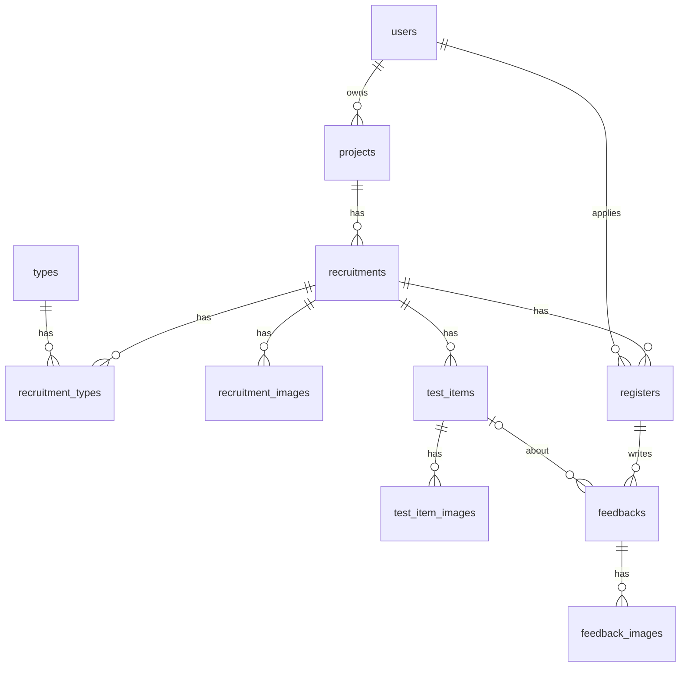

# 백엔드 프로젝트·테스터·피드백

프로젝트·모집글·테스트 항목·지원·피드백의 백엔드 계획([#34](https://github.com/likelion-backendschool-9th/test-moa/issues/34)). 여러 이슈에 걸친 결정과 데이터 구조는 이 문서에 두고, 이슈별 계획은 이 폴더의 `<기능>.md`로 나눈다.

## 이슈와 문서

| 이슈 | 내용 | 문서 |
| --- | --- | --- |
| [#89](https://github.com/likelion-backendschool-9th/test-moa/issues/89) | 프로젝트·테스터·피드백 엔티티 | [entities.md](entities.md) |
| [#92](https://github.com/likelion-backendschool-9th/test-moa/issues/92) | 프로젝트 등록·조회·수정과 모집 작성 API | [project-recruitment-api.md](project-recruitment-api.md) |

진행 상태는 이슈와 PR에서 본다.

프론트: [개발자 프로젝트](../../frontend/project/projects.md), [참여 테스트](../../frontend/project/participations.md), [모집글 상세](../../frontend/project/recruitment-detail.md)

## 정한 것
- [결제·구독·크레딧](../payment/README.md#정한-것)과 같은 기준을 쓴다. ERD보다 복잡하게 만들지 않고, 조건이 붙는 규칙은 백엔드가 맡는다.

| 어디서 | 무엇을 |
| --- | --- |
| 엔티티 메서드 | 상태 전이와 값끼리의 규칙. setter는 두지 않는다. 상태는 밖에서 받지 않고 메서드가 정한다 |
| 서비스(다음 이슈) | 다른 테이블까지 보는 규칙: 확정 테스터가 있는 모집의 취소 가능 여부, 선착순 자동 확정, 피드백 중복 제출, 필수 항목 누락 |

| # | 결정 | 이유 |
| --- | --- | --- |
| 1 | 피드백은 테스트 항목별 행으로 저장하고 한 번에 제출한다 | ERD와 개발자 화면이 항목별이다. 같은 `submittedAt`을 넣어 72시간 기준을 하나로 둔다 |
| 2 | 보상 스냅샷은 `Register`에 둔다 | ERD와 같다. 확정할 때 금액을 고정할 수 있고, 피드백이 여러 행이어도 보상은 참가당 한 번이다 |
| 3 | `recruit_count`를 뺀다 | 팀에서 모집 인원을 아예 빼기로 했고 ERD에서도 지웠다. 화면은 #78에서 뺀다 |
| 4 | `Feedback.testItem`은 null을 허용한다 | ERD 내보내기는 `NOT NULL`이지만 기타 의견을 null로 표현한다 |
| 5 | 테스트 항목 이미지는 `TestItemImage`다 | 프로젝트 이미지는 `projects.image_url`, 모집글 이미지는 `recruitment_images`가 맡아 테스트 항목 이미지만 남는다 |
| 6 | ERD에 `cancel_reason`, `cancelled_at`, `is_recommended`를 더한다 | 프론트 화면에 필요하고 ERD에 없다. 코드와 함께 ERD도 고친다 |
| 7 | 모집글의 주소 키로 slug를 저장하지 않는다 | ERD에 없다. 백엔드 API는 `recruitment_id`를 주소에 쓰고(11-06 팀 결정: 백엔드는 id), 프론트 페이지 URL의 key 자리에는 같은 id 값을 넣는다. slug는 필요해지면 더한다 (고침 #92: 백엔드 주소는 id로 통일) |
| 8 | 이미지는 프로젝트 대표(`projects.image_url`)·모집글(`recruitment_images`)·테스트 항목(`test_item_images`) 세 가지로 나눈다 (#92, 11-06) | 모집글 상세 이미지 띠와 항목별 이미지를 따로 보여 준다. 자세히는 [project-recruitment-api.md](project-recruitment-api.md#1-프로젝트모집-작성-api-92-r1) |

## 데이터 구조

| 테이블 | 한 행이 뜻하는 것 | 자세히 |
| --- | --- | --- |
| `projects` | 개발자의 소프트웨어 하나 | [entities.md 1](entities.md#1-프로젝트와-모집글-89-r1) |
| `recruitments` | 프로젝트의 테스트 모집 한 번 | [entities.md 1](entities.md#1-프로젝트와-모집글-89-r1) |
| `test_items` | 모집글의 테스트 항목 하나 | [entities.md 2](entities.md#2-테스트-항목-89-r2) |
| `registers` | 테스터 한 명의 지원·참가 한 건 | [entities.md 3](entities.md#3-지원과-참가-89-r3) |
| `feedbacks` | 테스트 항목 하나에 대한 피드백(기타 의견은 항목 없음) | [entities.md 4](entities.md#4-피드백-89-r4) |

## 다른 담당과 맞닿는 곳

| 담당 | 맞출 것 |
| --- | --- |
| 크레딧(#66) | 승인 대기 보상을 `Feedback(SUBMITTED)` 행의 합이 아니라 제출된 참가 건의 `Register` 스냅샷 합으로 계산한다. 피드백 행마다 더하면 중복된다. [결제·구독·크레딧](../payment/README.md#정한-것)의 관련 문장도 고친다 |
| 신고 | 신고가 접수되면 `report()`, 처리되면 `reward()` 또는 `exclude()`를 부른다 |
| 보상액 | `confirm`에 넘길 기본·추가 보상액을 정한다 |
| AI 분석 | 분석 테이블은 `recruitments`를 가리키고, `analysis_status`와 `version`은 #89에서 컬럼만 만들었다 |

## 아직 정하지 않은 것

| # | 무엇을 | 추천 |
| --- | --- | --- |
| 1 | 72시간 자동 지급 담당 | 크레딧 계획 문서는 프로젝트 도메인으로 적었다. 팀에서 확정한다 |
| 2 | 항목별 피드백 중 한 건만 신고되면 보상을 어떻게 할지 | **정함(#66):** 참가 전체 지급을 보류한다. 승인 대기는 `EXISTS SUBMITTED`이고 `NOT EXISTS REPORTED`일 때만 합산한다 |
| 3 | `RecruitmentStatus.CLOSED` | 화면 상태는 날짜로 계산하므로 지금은 저장하지 않고 남겨 둔다. API를 만들 때 지울지 정한다 |
| 4 | 보상 상한 | 모집 인원이 없어 선착순 지급에 상한이 없다. 팀에서 정한다 |

- ERD에 `cancel_reason`, `cancelled_at`, `is_recommended`와 `test_item_images` 이름을 반영하는 일
